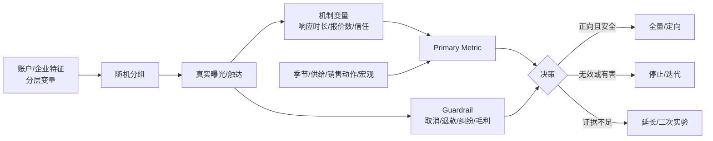
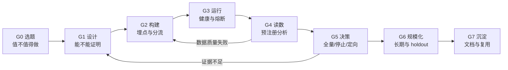
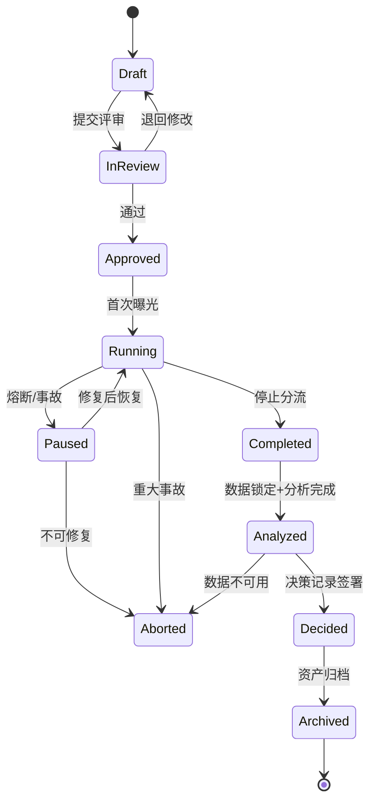
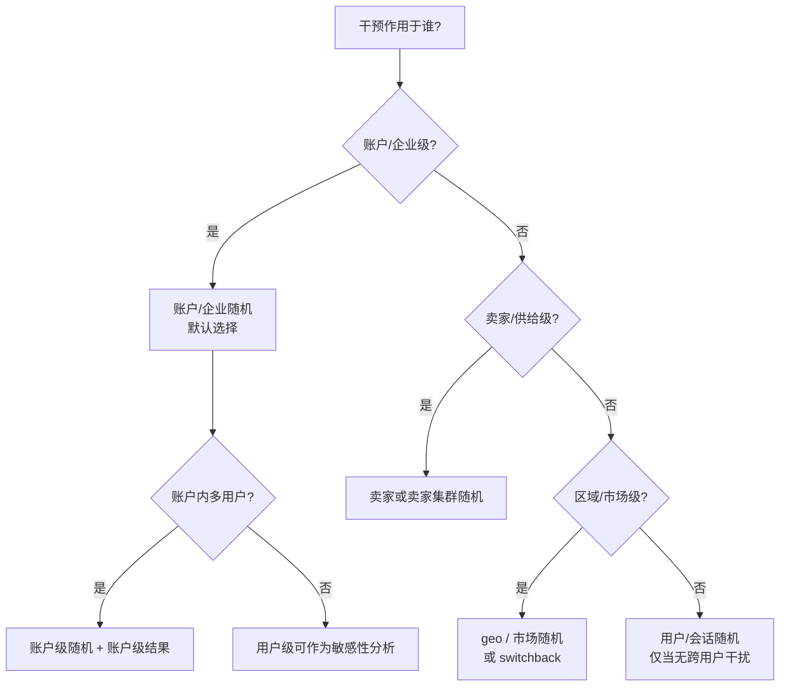
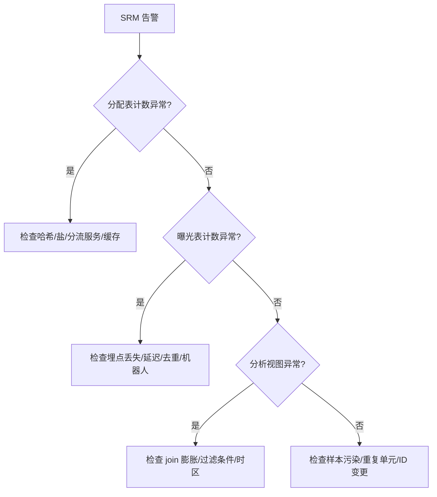
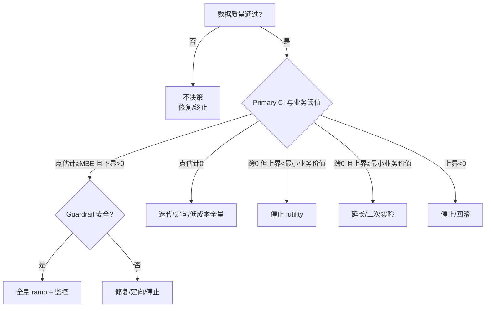
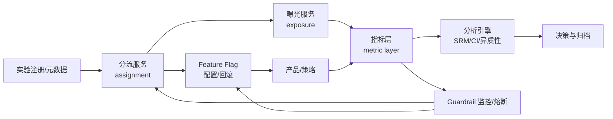

# B2B 电商平台实验规范

> **一句话目标**：让每一次实验都能回答一个可执行的业务问题，并且让答案可复现、可审计、可复用。

---

## 0. 阅读指南

### 0.1 为什么需要这份规范

B2B 电商的实验比 B2C 更容易“看起来做了、实际上没答案”：

- 客户是**企业**，样本是**账户/企业**而不是 UV，实验动辄只有几百个单元；
- 采购是**低频、长周期、多角色**决策，7 天窗口经常连一个完整决策链都覆盖不了；
- 干预经常发生在**账户级、销售区域级、商家级**，用用户级随机化会系统性低估或污染效应；
- 交易金额大、长尾重，均值方差极大，普通 t 检验的置信区间经常不可信；
- 平台是**双边市场**，库存、价格、履约、流量相互牵连，SUTVA 经常不成立；
- 一次错误的全量决策，损失可能是数百万的毛利、一批商家的信任，或者一个季度的供给。

因此，本规范不只定义“字段怎么填”，更定义**什么样的证据足以支撑什么级别的决策**。

### 0.2 适用范围

| 场景 | 是否适用 | 说明 |
|---|---|---|
| 平台功能、搜索、推荐、采购工作台 A/B | 适用 | 默认账户级随机 |
| 定价、阶梯价、账期、补贴 | 适用（需法务/财务会签） | 优先账户/企业级；注意转售与套利 |
| 商家工具、履约规则、卖家侧产品 | 适用 | 默认商家级或商家集群 |
| 销售激励、区域政策、渠道政策 | 适用（准实验优先） | 销售代表/区域为随机单元 |
| 全量上线后的长期效果 | 适用 | 需保留 holdout |
| 无法随机化的组织变革 | 部分适用 | 使用准实验方法，参照 1.4 与 9.4 |
| 涉及个人敏感数据、差别定价合规风险 | 需额外评审 | 见 12.3 |

### 0.3 规范用语

本文使用 RFC 2119 风格的关键词：

- **必须（MUST）**：硬性要求，违反时实验不得上线或结论不得进入决策。
- **禁止（MUST NOT）**：红线，出现即判定实验无效或需回滚。
- **应当（SHOULD）**：默认执行；不执行需在实验文档中写明理由并经评审。
- **可以（MAY）**：可选的最佳实践。

### 0.4 文档地图

| 章节 | 内容 | 主要读者 |
|---|---|---|
| 1 | B2B 实验的第一性原理与成熟度模型 | 所有人 |
| 2 | 全生命周期、Stage-Gate、RACI、预注册 | 负责人、评审人 |
| 3 | A. 实验身份：元数据与状态机 | 负责人、平台 |
| 4 | B. 实验设计：假设、单元、曝光、样本量 | 负责人、数据科学 |
| 5 | C. 数据质量：SRM、平衡性、污染、链路 | 数据科学、分析师 |
| 6 | D. 指标：指标树、口径、SQL、预设 | 分析师、业务 |
| 7 | E. 统计：效应、置信区间、多重检验、功效 | 数据科学 |
| 8 | F. 异质性：分层、交互、定向 | 数据科学、业务 |
| 9 | G. 长期：窗口、衰减、副作用、全量后 | 业务、数据科学 |
| 10 | H. 决策：全量、停止、定向、二次实验 | 业务 DRI、评审会 |
| 11 | I. 沉淀：文档、SQL、Dashboard、知识库 | 所有人 |
| 12 | 平台能力、数据模型、合规与审计 | 工程、平台 |
| 13 | 五道质量门禁（G1–G5）与归档检查 | 评审人 |
| 14 | 反模式与三个 B2B 案例 | 所有人 |
| 15 | 落地路线图（30/60/90 天）与阻力应对 | 管理者、实验负责人 |
| 16 | 附录：字段总表、术语、公式、模板、SQL、参考 | 所有人 |
| 17 | 一页纸总结 | 所有人 |

### 0.5 十条铁律

1. **先问决策，再问实验**：说不清“结果出来后要做什么决定”，就不要做。
2. **无预注册，不读主指标**：主指标、窗口、人群、检验方法必须在曝光前冻结。
3. **无 SRM 检查，不读结果**：分流比例异常时，所有结果都不可解释。
4. **无 Guardrail，不上线**：正向指标不能以生态或体验为代价。
5. **不显著 ≠ 无效**：必须同时报告置信区间、MDE 与功效。
6. **显著 ≠ 值得全量**：还要看效应大小、成本、可运营性与长期影响。
7. **不用用户级随机做账户级干预**：随机单元必须与干预作用层级对齐。
8. **不按结果改口径**：口径变更必须走 amendment 并保留时间戳。
9. **不把 7 天当长期**：B2B 至少看 30 天，最好 60–90 天与全量后 holdout。
10. **不记录失败，就会重复失败**：失败实验与阴性结果同样必须入库。

### 0.6 三张地图

一次高质量实验，本质上要把三张图画清楚：

| 地图 | 回答的问题 | 产出 |
|---|---|---|
| 因果图（DAG） | 干预通过什么机制影响什么指标？有哪些混杂与干扰？ | 假设、随机单元、协变量、guardrail |
| 指标树 | 北极星如何分解？本实验动哪一片叶子？ | Primary / Secondary / Guardrail |
| 决策树 | 不同结果分别触发什么动作？阈值是多少？ | 预注册决策规则、全量/停止/定向条件 |



---

## 1. B2B 实验的第一性原理

### 1.1 与 B2C 的八个结构性差异

| # | B2B 特征 | 对实验的直接影响 | 规范应对 |
|---|---|---|---|
| 1 | **单元少、单元大**：几百到几万家企业，而非百万 UV | 功效不足；最小可检测效应（MDE）往往很大 | 账户/企业级随机、分层、CUPED、配对设计、延长窗口、序贯检验 |
| 2 | **采购周期长、频次低**：从询盘到首单可能 2–12 周 | 7 天窗口严重不足；短期指标与长期指标背离 | 30/60/90 天窗口；cohort 分析；长期 holdout |
| 3 | **多角色决策链**：采购、使用、财务、法务、老板 | 曝光者 ≠ 决策者；用户级随机无法覆盖组织效应 | 账户级随机；组织级结果；记录关键角色行为 |
| 4 | **客单价高、长尾重**：少数大单主导 GMV | 均值方差极大；异常值左右结论 | 预注册 winsorize/trim；比率指标 + Delta 方法；bootstrap；分位数效应 |
| 5 | **双边市场与供给约束**：库存、价格、履约共享 | 组间干扰（interference）；SUTVA 不成立 | 商家级/区域级集群随机；switchback；geo 实验；饱和设计 |
| 6 | **销售/渠道深度介入**：线下拜访、返点、合同 | 处理污染；依从性不完整 | 按销售代表/区域随机；记录 CRM 动作；ITT 为主、TOT 为辅 |
| 7 | **身份复杂**：一企多账号、多设备、代运营 | 重复用户、跨组泄露、分母虚高 | 企业 canonical ID；身份图谱；账户级去重 |
| 8 | **合同与合规约束**：协议价、账期、区域授权 | 不是所有杠杆都能随机 | 法务/财务会签；准实验；政策分批上线 |

**业务模式再叠加一层约束**：

| 平台模式 | 典型实验杠杆 | 默认随机单元 | 额外 Guardrail |
|---|---|---|---|
| 自营/经销 | 价格、库存、账期、履约时效 | 企业/合同账户；区域 | 毛利、履约成本、库存周转 |
| 平台/撮合 | 流量分配、排序、商家工具、佣金 | 商家/卖家集群；区域 | 商家留存、买家纠纷、生态集中度 |
| 混合（自营 + 平台） | 同场流量、价格、履约 | 企业/商家/区域，分层隔离 | 自营与平台互相蚕食、公平性 |
| 跨境 B2B | 关税、物流、支付、合规 | 市场/国家；企业 | 清关时效、汇率、合规风险 |

> 同一个“实验”在不同模式下可能是完全不同的因果问题。设计前先确认：**谁被随机、谁承担成本、谁感知体验、谁承担风险**。

### 1.2 因果推断的五个前提

任何 A/B 实验的结论都建立在以下前提上。B2B 场景要逐条检查，而不是默认成立。

| 前提 | 含义 | B2B 常见违反 | 检查/补救 |
|---|---|---|---|
| **一致性（Consistency）** | 观测到的结果等于该单元在所受处理下的潜在结果 | 同一账户同时受到多个版本影响 | 互斥层；版本唯一；曝光日志 |
| **正性（Positivity）** | 每个单元都有非零概率进入任一组 | 战略客户被强制排除；销售只给大客户开通 | 明确 eligibility；报告排除规则 |
| **可忽略性（Ignorability）** | 分组与潜在结果独立 | 按客户价值/区域手工分组 | 随机/分层随机；平衡性检查 |
| **SUTVA / 无干扰** | 一个单元的结果不受其他单元处理影响 | 库存共享、价格参照、销售串单、买家跨组 | 集群随机、switchback、geo、饱和设计 |
| **正确 estimand** | 估计量与实际决策问题一致 | 用曝光者效应替代全量效应 | 预注册 ITT/TOT/CATE；敏感性分析 |

> **关键判断**：如果 SUTVA 明显不成立，用户级 A/B 的“显著性”没有决策价值。此时必须升级随机单元，或改用 switchback/geo 设计。

### 1.3 实验成熟度模型

| 等级 | 特征 | 典型缺口 | 升级动作 |
|---|---|---|---|
| **L1 能跑** | 有分流、有报表、能算 p 值 | 无 SRM、无预注册、口径随意 | 建字段字典、SRM 日检、上线门禁 |
| **L2 可信** | 预注册、功效计算、guardrail、平衡性检查 | 账户级设计不统一；污染未评估 | 随机单元决策树、集群稳健方差、CUPED |
| **L3 高效** | 分层、CUPED、序贯、互斥、自动熔断 | 异质性与长期不足 | 预注册 subgroups、长期 holdout、效应量库 |
| **L4 组合** | 实验组合优化、meta-analysis、定向策略 | 组织学习未闭环 | 知识库、复用率、决策自动化 |
| **L5 自适应** | 连续实验、因果 ML、政策学习 | 治理与合规风险 | 模型审计、公平性评估、人工否决权 |

### 1.4 什么时候不该做 A/B

以下情形应直接放弃随机实验，改用准实验或决策记录：

- **不可逆/高风险**：可能造成大规模资金损失、法律风险、商家集体流失；
- **无 equipoise**：已有强证据表明某版本明显更优，随机到较差版本不道德；
- **总体极小**：可用单元少于约 50 个，任何随机化都无法提供有效功效；
- **无法稳定交付**：版本频繁变更、埋点不可靠、实验期覆盖不了业务周期；
- **强干扰且无法集群化**：价格战、库存共享且无法按市场切换；
- **指标不可观测**：关键结果在平台外发生，且无代理指标。

替代方法：前后对比 + 合成控制、中断时间序列（ITS）、双重差分（DID）、倾向得分匹配、switchback、地理实验、分批上线（staggered rollout）。这些方法必须在文档中写明识别假设与敏感性分析。

---

## 2. 全生命周期与治理

### 2.1 八阶段 Stage-Gate（G0–G7）



| 阶段 | 核心问题 | 关键产出 | 通过条件（Gate） | 负责人 |
|---|---|---|---|---|
| **G0 选题** | 值不值得做？失败会怎样？ | 一页纸：问题、证据、影响面、备选方案、预期收益 | 有明确决策、有可测指标、有初步功效判断 | 业务 DRI |
| **G1 设计** | 能不能证明？ | 实验设计文档、DAG、样本量、指标口径、分析计划 | 预注册冻结；ERC 评审通过 | 实验负责人 |
| **G2 构建** | 能不能正确交付？ | 分流服务、曝光埋点、功能开关（Feature Flag）、DQ 测试、A/A（如需） | 埋点验收；SRM 预演；回滚预案 | 工程 |
| **G3 运行** | 有没有跑坏？ | 每日健康卡、SRM/guardrail 告警、事故记录 | 无 S1 数据事故；无 guardrail 熔断 | 实验负责人 |
| **G4 读数** | 结果是什么？ | 预注册分析、敏感性分析、异质性、长期 | 数据锁定；DQ 通过；分析可复现 | 数据科学 |
| **G5 决策** | 接下来做什么？ | 决策记录（全量/停止/定向/二次） | 业务 DRI 签字；guardrail owner 无否决 | 业务 DRI |
| **G6 规模化** | 全量后还成立吗？ | ramp 计划、holdout、30/60/90 天报告 | 规模化监控通过；无长期副作用 | 业务 + 数据科学 |
| **G7 沉淀** | 别人能复用吗？ | 实验文档、SQL、Dashboard、知识卡片 | 资产验收；归档 | 实验负责人 |

### 2.2 角色与 RACI

> R = 负责执行；A = 最终负责；C = 需咨询；I = 需知会。

| 活动 | 实验负责人 | 数据科学 | 分析师 | 工程 | 业务 DRI | 平台/ERC | 法务/财务 |
|---|---|---|---|---|---|---|---|
| 选题与价值评估 | R | C | C | I | A | I | I |
| 假设与设计 | A/R | R | C | C | C | C | C |
| 样本量与功效 | C | A/R | C | I | I | C | I |
| 指标口径 | C | A/R | R | I | C | I | I |
| 分流与埋点 | C | C | I | A/R | I | C | I |
| 数据质量 | C | A/R | R | C | I | C | I |
| 读数与分析 | C | A/R | R | I | C | C | I |
| 决策 | R | C | C | I | A | C | C |
| 全量与长期 | R | R | C | C | A | I | I |
| 沉淀与归档 | A/R | C | R | C | I | C | I |
| 合规与隐私 | C | C | I | C | C | C | A/R |

**关键制衡**：

- 实验负责人不能同时是唯一的数据分析人（避免“自己设计、自己读数、自己宣布成功”）；
- Guardrail Owner 对全量拥有一票否决权；
- 战略客户、定价、合同条款类实验必须法务/财务会签；
- ERC 只评审方法与风险，不替业务做决策。

### 2.3 预注册（Pre-registration）与冻结

在实验首次曝光前，必须冻结以下内容，并记录**文档版本号 + 内容哈希 + 冻结时间**：

**必须冻结**：
1. 主要估计量（ITT / TOT / CATE）与分析人群；
2. Primary Metric 的精确定义、窗口、分母、去重规则；
3. Secondary / Guardrail 清单与方向；
4. 假设检验类型、单/双侧、α、功效、MDE；
5. 随机单元、分层变量、分流比例；
6. 多重检验校正范围与方法；
7. 异质性分析的维度与假设；
8. 异常值处理、缺失值处理、winsorize 分位点；
9. 停止/延长/熔断规则；
10. 决策阈值（什么结果对应什么动作）。

**允许的变更**：只能通过 **Amendment**，记录变更原因、时间、影响，并注明“在看到分组结果前/后”。看到结果后变更主指标，视为 **HARKing**，结论只能标记为探索性。

### 2.4 熔断与伦理

出现以下任一情况，必须立即暂停实验或回滚：

- Guardrail 越过预注册的安全阈值，且持续超过约定观察窗；
- 出现资金、合同、价格、隐私或合规事故；
- 分流/曝光出现系统性错误，无法在 24 小时内修复；
- 对某一类客户造成可识别的系统性伤害；
- 实验组与对照组体验差异引发商家/客户投诉升级。

熔断不是失败，而是治理有效的证据。熔断记录必须进入实验档案，并在复盘中区分“机制失败”与“执行失败”。

---

## 3. 模块 A · 实验身份（Identity）

### 3.1 设计原则

实验身份不是“起个名字”，而是**实验的主键与证据链起点**。它要满足四个条件：

1. **唯一**：一个 Experiment ID 只对应一次分流与一个分析计划；
2. **不可变**：ID 一旦生成，不得复用、不得改绑；
3. **可追溯**：能链到需求、代码、埋点、SQL、Dashboard、决策记录；
4. **可机读**：核心字段结构化，能进入实验平台与元数据仓库。

### 3.2 字段的通用信封

所有字段建议以统一信封存储，避免“只有结论、没有方法”：

```json
{
  "field_id": "C02",
  "value": { "chi_square": 3.21, "p_value": 0.073, "threshold": 0.001, "status": "pass" },
  "method": "chi-square goodness-of-fit on assignment counts",
  "source": "exp_assignment@2026-11-18",
  "owner": "ds_zhang",
  "updated_at": "2026-11-19T09:00:00+08:00",
  "evidence_url": "https://bi.example.com/exp/EXP-B2B-20261118-001/srm"
}
```

> 没有 `method` 与 `source` 的数字，不得进入决策材料。

### 3.3 字段字典

| ID | 字段 | 类型 · 必填 | 定义与填写规范 | 示例 | 校验 |
|---|---|---|---|---|---|
| A01 | **Experiment ID** | string · 必须 | 全局唯一、不可变。格式 `EXP-{BU}-{YYYYMMDD}-{NNN}`；BU 用 2–6 位大写字母；NNN 为当日序号。禁止复用已归档 ID。 | `EXP-B2B-20261118-001` | 正则 `^EXP-[A-Z]{2,6}-\d{8}-\d{3}$`；唯一性约束 |
| A02 | **实验名称** | string · 必须 | 格式 `{业务域}｜{干预摘要}｜{人群}`，≤ 40 字；写“做了什么”，不写“结果很好”。 | `采购工作台｜报价 4h SLA｜近 90 天询盘未下单企业` | 长度；禁用“成功/显著/提升”等结论词 |
| A03 | **实验负责人** | string · 必须 | 唯一 DRI 的真实姓名/工号，另填备份人；禁止只写团队邮箱。 | `张晨（zhangchen）／备份：李旻` | 组织架构校验；在职状态 |
| A04 | **开始时间** | datetime · 必须 | 首次真实曝光的时间，ISO 8601 带时区；与“计划开始”分开存储。 | `2026-11-18T10:00:00+08:00` | 不得晚于 A05；不得晚于首次曝光日志 |
| A05 | **结束时间** | datetime · 必须 | 最后一次曝光的截止时间；明确“停止分流”与“停止分析”是两件事。 | `2026-12-16T23:59:59+08:00` | 与数据截止时间、分析窗口一致性校验 |
| A06 | **实验状态** | enum · 必须 | 见 3.4 状态机。只允许相邻合法迁移；每次迁移写操作人、时间、原因。 | `Running` | 状态机约束；非法迁移拒绝 |
| A07 | **实验背景** | text · 必须 | 六段式：现状与基线 → 证据（数据/访谈/投诉）→ 影响面 → 根因假设 → 为什么现在 → 备选方案与不做的代价。 | 见下方模板 | 至少 200 字；必须含基线数字与来源 |
| A08 | **业务目标** | text · 必须 | 格式：`对{人群}，在{期限}内，使{结果指标}从{基线}达到{目标}，同时不损害{约束}`；须对齐 OKR，区分 output 与 outcome。 | `对中小制造企业新客，30 天内将询盘→首单转化率从 12% 提升至 13.8%，取消率不升破 3%` | 含基线、目标、期限、约束；禁止“提升体验”类空话 |

**A07 背景模板**

```markdown
### 现状与基线
- 指标基线：询盘→首单转化率 12.0%（过去 90 天，n=8,420 家企业）
- 分渠道：销售线索 18%，自然流量 7%，伙伴 9%
### 证据
- 2026Q3 买家访谈 23 场：11 家提到“报价等待超过 1 天就转向别家”
- 客服工单：报价相关投诉占 14%，同比 +5pp
### 影响面
- 每月约 2,800 家活跃询盘企业；预计可影响 340 个首单
### 根因假设
- 报价响应时长 → 决策等待 → 比价流失
### 为什么现在
- Q4 是采购预算释放期；竞品上线了 2h 报价承诺
### 备选方案与不做的代价
- 备选：报价提醒、报价模板、卖家分层 SLA；不做预计每季度损失约 600 个首单
```

**A08 目标 vs 手段**

| 写法 | 评价 | 原因 |
|---|---|---|
| “提升报价效率” | ❌ | 是手段，不是结果；不可证伪 |
| “把平均报价时长从 18h 降到 6h” | ⚠️ | 是机制指标，需绑定业务结果 |
| “30 天内把询盘→首单转化率从 12% 提到 13.8%，取消率不升破 3%” | ✅ | 有人群、期限、基线、目标、约束 |

### 3.4 状态机



| 状态 | 含义 | 允许动作 |
|---|---|---|
| `Draft` | 草稿，未评审 | 编辑、删除 |
| `InReview` | 评审中 | 评审、退回 |
| `Approved` | 设计冻结，可上线 | 启动、撤回 |
| `Running` | 正在分流/曝光 | 监控、暂停、停止 |
| `Paused` | 暂停分流，保留数据 | 恢复、终止 |
| `Completed` | 已停止曝光，等待分析 | 数据锁定 |
| `Analyzed` | 分析完成，待决策 | 决策会 |
| `Decided` | 已记录决策 | 全量/归档 |
| `Archived` | 只读归档 | 查询、复用 |
| `Aborted` | 终止，需写明原因 | 归档、复盘 |

### 3.5 命名与关联规范

- **ID 不复用**：即使实验重启，也生成新 ID，并在 A01 备注 `restart_of`。
- **一实验一主文档**：文档 URL 写入元数据；禁止“结论散落在群聊”。
- **三链合一**：Experiment ID 必须同时出现在分流表、曝光日志、指标 SQL 的过滤条件中。
- **关联字段**：需求单、代码 PR、功能开关（Feature Flag）、Dashboard、决策记录、知识卡片，全部以 ID 外键关联。

### 3.6 建议扩展字段（不替代 61 字段）

| 字段 | 用途 | 示例 |
|---|---|---|
| 实验类型 | A/B、A/B/n、switchback、geo、holdout、准实验 | `account_level_ab` |
| 风险等级 | R0–R3，决定评审层级 | `R2`（涉及价格） |
| 目标人群 | eligibility 规则 | `近90天有询盘、无首单、非战略客户` |
| 排除规则 | 内部账号、测试企业、已参加冲突实验 | `is_internal=0 AND in_conflict=0` |
| 合规审批 | 法务/财务/隐私审批单号 | `LEGAL-2026-1187` |
| 预算/成本 | 实验直接成本与机会成本 | `¥180,000` |
| 关联实验 | 互斥、正交、前后序 | `EXP-B2B-20261020-004` |

### 3.7 反模式

| 反模式 | 后果 | 纠正 |
|---|---|---|
| 用“测试1/测试2”当名称 | 三个月后无人知道做了什么 | 统一命名模板 |
| 一个 ID 下多次改版本 | 结果无法归因 | 新版本 = 新 ID 或显式 amendment |
| 负责人写团队名 | 出问题无人负责 | 真实 DRI + 备份 |
| 背景只有一句“领导要求” | 无法判断是否值得做 | 六段式背景 |
| 目标写“提升转化” | 不可证伪、不可验收 | 基线 + 目标 + 期限 + 约束 |

---

## 4. 模块 B · 实验设计（Design）

### 4.1 假设：从“想法”到“可证伪的因果陈述”

**标准模板**：

> 在 **{人群}** 中，将 **{干预}** 从 **{对照}** 改为 **{治疗}**，预期 **{Primary Metric}** 在 **{窗口}** 内相对提升 **≥ {MDE}**；机制是 **{因果链}**；若 **{Guardrail 恶化阈值}** 或 **{反驳证据}** 出现，则假设不成立。

**合格假设的五个标准**：

1. **可证伪**：能明确写出“什么结果算失败”；
2. **有机制**：不是“试试看”，而是能画出 DAG；
3. **有边界**：人群、窗口、场景明确；
4. **有效应量**：给出 MDE，而不是“越高越好”；
5. **有约束**：guardrail 与副作用预先声明。

**B2B 示例（合格）**：

> 在近 90 天有询盘但未下单的中小制造企业采购账户中，将卖家报价响应 SLA 从 24h 缩短至 4h，预期 30 天内询盘→首单转化率相对提升 ≥ 8%；机制是缩短等待、降低比价流失、提升采购方对平台确定性的感知；若订单取消率上升超过 2pp、或卖家报价率下降超过 5pp，则假设不成立。

**不合格假设的典型**：

| 写法 | 问题 |
|---|---|
| “新版工作台更好用” | 无指标、无机制、无边界 |
| “预计提升 30%” | 无基线、无依据、无 MDE 逻辑 |
| “看看有没有效果” | 无决策规则，属于探索而非实验 |
| “提升 GMV” | 太宽，无法归因到具体机制 |

### 4.2 随机化单元：先对齐干预层级

**决策顺序**：干预在哪一层发生 → 干扰在哪一层传播 → 哪一层有稳定 ID → 哪一层能提供足够功效。



| 干预类型 | 默认随机单元 | 备选 | 关键风险 |
|---|---|---|---|
| 搜索/推荐/工作台 UI | 买家账户（company/account） | 用户（仅单用户账户） | 同账户多用户互相影响 |
| 定价、阶梯价、折扣 | 企业/合同账户 | 市场/区域（若价格公开） | 转售、套利、价格参照 |
| 账期、信用、金融 | 企业 | 无 | 合规、风险敞口 |
| 卖家工具/履约 | 卖家 ID | 卖家集群（区域/类目） | 买家跨卖家、库存共享 |
| 物流/仓配 | 仓库/区域 | switchback | 履约网络溢出 |
| 库存分配 | 市场/区域 | switchback | 供给干扰强 |
| 销售激励/区域政策 | 销售代表/团队/区域 | 配对区域 | 销售串单、跨区抢客 |
| 平台规则/流量分配 | 市场/区域 | 分批上线 | 生态效应 |
| 新客 onboarding | 企业 | 无 | 同一企业多账号 |

**分流算法规范**：

```text
bucket = murmur3(salt || canonical_unit_id) mod 10000
variant = "control" if bucket < 5000 else "treatment"
```

- `salt` 必须每次实验唯一、记录在案；禁止使用会随配置变化的字段作为 salt；
- 同一实验内，同一 `canonical_unit_id` 必须稳定落入同一组；
- 单元数 < 500 时，应当使用**分层区组随机**（stratified block randomization），保证关键变量平衡；
- 禁止“跑了一半再重新随机”；
- 分层变量应选**实验前**、与结果强相关、且样本内可观测的变量（如企业规模、行业、历史 GMV 分层、区域、销售渠道）。

**集群随机的设计效应**：

```text
DEFF = 1 + (m - 1) × ρ
n_effective = n_total / DEFF
```

其中 `m` 为集群平均大小，`ρ` 为组内相关系数（ICC）。示例：账户平均 5 个采购用户，ICC=0.05，则 DEFF=1.2；若 ICC=0.2，则 DEFF=1.8，等效样本降至约 56%。

**特殊设计要点**：

| 设计 | 适用 | 关键要求 |
|---|---|---|
| **Switchback** | 库存、供给、履约等强干扰场景 | 时间块长度 > 携带效应；设置洗脱期；块顺序随机；检验遗留效应 |
| **Geo / 市场实验** | 区域政策、公开价格、平台规则 | 市场可比；检查跨市场溢出；用合成控制/DID 辅助 |
| **集群随机** | 卖家、区域、仓库 | 报告 ICC、DEFF、集群数；集群数 <30 用 wild bootstrap |
| **Holdout** | 全量后的长期效应 | 5%–10%；代表性；伦理与退出机制 |

### 4.3 Treatment 与 Control：把“版本”定义清楚

| 要素 | 必须记录 | 说明 |
|---|---|---|
| 版本号 | `treatment_v1.2.0` | 任何配置变更都要升版本 |
| 开关/参数 | 具体取值、默认值、灰度逻辑 | 禁止“代码里写死但文档没写” |
| 对照类型 | 现行生产 / 无功能 / 安慰剂 | B2B 默认“现行生产” |
| 交付方式 | 前端渲染 / 后端策略 / 人工执行 | 人工执行需记录 CRM 动作 |
| 依从性 | 实际收到处理的比例 | 低依从会稀释 ITT 效应 |
| 盲法 | 买家/卖家/销售是否知情 | 知情可能改变行为 |
| 回滚 | 开关、阈值、责任人 | 必须在上线前演练 |

**Control 的三条红线**：

1. 禁止用“历史同期”代替同期对照（除非准实验设计并写明假设）；
2. 禁止对照组偷偷上线部分功能（会导致效应被稀释且无法解释）；
3. 禁止在实验中途改变 Control 的版本；如必须改，走 amendment 并重新计算。

### 4.4 Exposure：区分“被分组”“被触达”“真曝光”

B2B 实验最常见的偏差，是把“分到 treatment”当成“受到 treatment”。

**五层漏斗**：

```text
Eligible（符合条件）
  → Assigned（被分流）
    → Reached（功能可用/页面可达）
      → Exposed（真实渲染或交互）
        → Analyzable（数据完整、可分析）
```

| 概念 | 定义 | 典型日志 |
|---|---|---|
| Eligibility | 满足人群规则、未被排除 | `exp_eligibility` |
| Assignment | 被哈希分到某组 | `exp_assignment` |
| Reached | 请求到达实验场景，但未必看到 | `exp_reach` |
| Exposure | 组件真实渲染/接口真实生效/销售真实执行 | `exp_exposure`、`crm_action` |
| Analyzable | 曝光 + 指标窗口完整 + 非内部账号 | 分析视图 |

**Exposure 事件最小 schema**：

```json
{
  "exp_id": "EXP-B2B-20261118-001",
  "unit_id": "C_883721",
  "unit_type": "company",
  "variant": "treatment",
  "exposure_ts": "2026-11-18T10:03:21+08:00",
  "surface": "quote_workbench",
  "session_id": "s_91f2",
  "server_ts": "2026-11-18T10:03:21+08:00",
  "source": "web",
  "is_bot": false
}
```

**分析人群的选择**：

| 人群 | 用途 | 注意 |
|---|---|---|
| **ITT（全部被分配）** | **默认主分析** | 保留随机化优势；效应会被未曝光稀释 |
| Exposed（真实曝光） | 次要分析/机制解释 | 可能引入选择偏差；不能替代 ITT |
| TOT/CACE（依从者） | 评估“真正使用”的效应 | 需要工具变量；解释要谨慎 |
| Per-protocol | 敏感性分析 | 不能作为唯一结论 |

> **B2B 特别规则**：如果 treatment 由销售/运营人工执行，必须记录 `treatment_applied`（CRM 字段），并区分“政策已下达”与“客户已感知”。主分析仍按 ITT；TOT 只用于解释机制。

### 4.5 实验比例与实验周期

**比例**：

- 默认 **50/50**；这是统计功效最高、解释最简单的设计；
- 高风险实验可以 **5% → 20% → 50% → 100%** 分批 ramp，但 ramp 决策不得基于主指标结果；如基于结果，必须使用序贯设计；
- 小样本场景不要做 90/10：对照组太少，guardrail 与异质性都看不清；
- 比例必须写入预注册；实际比例由 SRM 检查验证。

**周期**：

| 约束 | 要求 |
|---|---|
| 业务周期 | 至少覆盖 1 个完整采购/结算周期；B2B 建议 ≥ 4 周 |
| 决策周期 | 覆盖月结、季末、预算释放等关键节点，或明确避开 |
| 样本量 | 达到预注册的 analyzable 样本；不能“跑够天数但样本不足” |
| 新奇效应 | 至少观察 2 周，区分早期兴奋与稳定效果 |
| 长期 | 30 天起步；涉及复购/留存看 60–90 天 |
| 变更冻结 | 实验期内不得改主流程；紧急修复需记录并评估影响 |

**计划周期 ≠ 分析窗口**：实验可能运行 6 周，但主指标窗口是“曝光后 30 天”；两者必须分开写，避免把“运行时长”当成“观察时长”。

### 4.6 互斥、正交与 Holdout

| 机制 | 目的 | 实现 | 注意 |
|---|---|---|---|
| **互斥层（Layer）** | 防止同一单元同时进入相互影响的实验 | 同一 layer 内按槽位互斥 | 价格、补贴、合同类应独立层 |
| **正交（Orthogonal）** | 让多个实验独立，不互相稀释 | 不同 salt 的独立哈希 | 仍需检查业务冲突 |
| **冲突组（Conflict Group）** | 语义上不能同时存在的实验 | 配置冲突矩阵 | 同指标、同页面、同人群优先判冲突 |
| **Holdout** | 测量全量后的长期效应 | 随机保留 5%–10% 不处理 | 需长期维护，避免污染 |

**冲突判定四问**：

1. 是否作用于同一批单元？
2. 是否改变同一个 Primary/Guardrail？
3. 是否在同一页面/流程/决策点上？
4. 是否在时间上重叠且无法分离？

四个问题任一为“是”，就应互斥或明确建模交互。

### 4.7 样本量与功效：B2B 的“贵”与“少”

**均值型指标（每臂）**：

```text
n = 2 × (z_{1-α/2} + z_{1-β})² × σ² / Δ²
```

**比例型指标（每臂）**：

```text
n = (z_{1-α/2} + z_{1-β})² × [p₀(1-p₀) + p₁(1-p₁)] / (p₁-p₀)²
```

**集群随机**：

```text
n_total_adjusted ≈ n_individual × [1 + (m-1)ρ]
n_clusters ≈ n_total_adjusted / m
```

**MDE（给定 n）**：

```text
Δ = (z_{1-α/2} + z_{1-β}) × sqrt(2σ²/n)
```

在 α=0.05、power=0.8 时，`(1.96+0.8416)² ≈ 7.85`。

**比例指标所需样本量（每臂，未含集群膨胀）**：

| 基线转化率 | 相对 MDE 10% | 20% | 30% | 50% |
|---:|---:|---:|---:|---:|
| 4% | 39,500 | 10,300 | 4,800 | 1,860 |
| 10% | 14,700 | 3,840 | 1,770 | 683 |
| 20% | 6,510 | 1,680 | 768 | 290 |

> 这张表解释了一个残酷事实：**B2B 的低转化率 + 小样本，决定了在常见样本规模下，大多数实验只能检测 20%–50% 的 relative lift**。如果业务只能接受 5% 的提升，那么正确做法不是“硬跑”，而是：换成更敏感的指标、用 CUPED/分层、扩大到企业级长期窗口、或承认证据不足。

**方差削减（CUPED）**：

```text
Y_adj = Y - θ × (X - E[X])
θ = Cov(Y, X) / Var(X)
方差削减 ≈ ρ²（剩余方差 ≈ 1 - ρ²）
```

若实验前指标与结果相关性 ρ=0.6，方差降低 36%，等效样本增加约 56%。B2B 应优先使用**实验前 4–8 周**的账户级指标作为协变量；禁止使用实验期内的后处理变量。

### 4.8 字段字典

| ID | 字段 | 类型 · 必填 | 定义与填写规范 | 示例 | 校验 |
|---|---|---|---|---|---|
| B01 | **Hypothesis** | text · 必须 | 按 4.1 模板写；含人群、干预、对照、指标、窗口、MDE、机制、反驳条件。 | 见 4.1 示例 | 必须含 MDE 与 guardrail 阈值 |
| B02 | **Treatment** | object · 必须 | `{name, version, config, delivery, compliance}`；写清“实际发生了什么”，不是“代码分支叫什么”。 | `{name:"4h报价SLA", version:"v1.2", config:{sla_hours:4}, delivery:"server+CRM"}` | 版本号；配置快照；上线 PR |
| B03 | **Control** | object · 必须 | 同上；注明对照类型（现行生产/无功能/安慰剂）与对照版本。 | `{type:"current_production", version:"prod_2026.11"}` | 对照版本必须同期可查 |
| B04 | **Randomization Unit** | object · 必须 | `{unit_type, unit_id_field, hash_salt, strata, block_rule}`；单元必须与干预层级一致。 | `{unit_type:"company", hash_salt:"b2b_quote_sla_20261118", strata:["industry","gmv_band"]}` | 与曝光日志 unit_id 一致 |
| B05 | **Exposure定义** | text · 必须 | 写清“什么事件算曝光”、触发条件、日志表、时间戳、去重规则；区分 reached 与 exposed。 | `quote_workbench 首次渲染且 experiment_id 非空；同一 company 每日去重` | 事件名存在；埋点验收通过 |
| B06 | **实验比例** | object · 必须 | `{control, treatment, ramp_plan}`；比例之和为 100%；ramp 不得基于主指标。 | `{control:50, treatment:50, ramp:"5→25→50"}` | SRM 校验；比例与分流表一致 |
| B07 | **实验周期** | object · 必须 | `{planned_start, planned_end, min_business_cycles, primary_window, long_term_windows}`；明确“运行期”与“观察期”。 | `{planned_start:"2026-11-18", planned_end:"2026-12-16", primary_window:"30d"}` | 覆盖 ≥1 个完整业务周期 |
| B08 | **实验互斥** | object · 必须 | `{layer, conflict_group, excluded_exp_ids, orthogonal_to}`；画清互斥关系。 | `{layer:"pricing", conflict_group:"quote_pricing", excluded:["EXP-...-004"]}` | 冲突检测通过；无同层重叠 |

### 4.9 设计评审清单（G1 Gate）

- [ ] 假设可证伪，含 MDE、机制、反驳条件；
- [ ] 随机单元与干预层级一致；账户/企业级优先；
- [ ] 分层变量是实验前变量，且与结果相关；
- [ ] Treatment/Control 版本、配置、交付方式已冻结；
- [ ] Exposure 事件已定义并通过埋点验收；
- [ ] 样本量/功效计算可复现，含集群膨胀与 CUPED 说明；
- [ ] 实验周期覆盖完整业务周期，避开或显式处理季末/大促；
- [ ] 互斥/正交关系已检查，冲突实验已排除；
- [ ] Primary/Secondary/Guardrail 已预注册；
- [ ] 分析计划含缺失值、异常值、多重检验、异质性、停止规则；
- [ ] 回滚与熔断方案已演练；
- [ ] 法务/财务/隐私（如适用）已会签。

---

## 5. 模块 C · 数据质量（Data Quality）

### 5.1 质量分级与门禁

| 级别 | 定义 | 示例 | 处理 |
|---|---|---|---|
| **S1 阻断** | 结论不可解释，必须修复或终止 | SRM p<0.001；曝光日志缺失 >20%；分流非随机；指标 pipeline 错误 | 不得读数；不得决策；24h 内升级 |
| **S2 重大** | 结论可信度显著下降 | 平衡性 SMD>0.2；曝光率组间差 >10pp；业务重复率 >2%；缺失 >5% | 必须修复或做敏感性分析；决策会披露 |
| **S3 一般** | 影响有限，需记录 | 文档缺项；字段命名不一致；刷新延迟 <2h | 记录并限期整改 |

### 5.2 样本量：四个数字必须同时报告

| 数字 | 含义 | 用途 |
|---|---|---|
| **Planned** | 设计时计算的每臂样本 | 判断是否达到功效 |
| **Assigned** | 实际分流到的单元数 | SRM 的基数 |
| **Exposed** | 真实曝光的单元数 | 解释稀释与依从性 |
| **Analyzable** | 进入主分析、指标窗口完整的单元数 | 最终功效 |

**规则**：

- 实际 analyzable < 计划 80% 时，必须标记“功效不足”，不得把不显著解释为“无效果”；
- 流失（attrition）必须在组间比较；差异 >5pp 需排查；
- 禁止在看到结果后“补样本直到显著”；如要延长，必须使用预注册的序贯设计或盲态样本量重估。

### 5.3 SRM：分流比例检查

**做法**：对 `Assigned` 计数做卡方拟合优度检验。

```text
χ² = Σ (O_i - E_i)² / E_i,  df = k - 1
```

- 阈值：**p < 0.001** 视为 S1；0.001 ≤ p < 0.01 需排查并记录；
- 必须分别检查：总体、按天、按平台、按渠道、按分层变量；
- 曝光计数也可以做 SRM，但它受真实行为影响，不能替代分配 SRM。

**排查树**：



**常见根因**：

| 根因 | 表现 | 修复 |
|---|---|---|
| 哈希实现不一致 | 某组持续偏多 | 统一 hash 库与 salt |
| 重定向/登录后重新分流 | 曝光组比例漂移 | 以稳定 ID 分流，登录后不重算 |
| 机器人/爬虫 | treatment 曝光异常高 | 过滤 bot；分配层不受影响 |
| 埋点丢失 | 某端曝光少 | 补埋点；按端分层分析 |
| Join 膨胀 | 分析样本翻倍 | 先聚合到单元级再 join |
| 时区/分区错误 | 某天数据缺失 | 统一 UTC+8；校验分区 |

### 5.4 实验前平衡性

**检查项**：

| 检查 | 方法 | 阈值 |
|---|---|---|
| 连续变量 | 标准化均值差 SMD | `SMD < 0.1` 良好；`>0.2` 需处理 |
| 分类变量 | 各水平占比差 / 卡方 | 结合业务判断 |
| 方差 | 方差比 | 0.5–2.0 |
| 分布 | KS 检验 / 分位数对比 | 关注尾部 |
| 联合 | 多变量模型 / 整体平衡指数 | 需预注册 |

```text
SMD = (mean_T - mean_C) / sqrt((s_T² + s_C²) / 2)
```

**处理原则**：

1. 先检查是否为**随机波动**（尤其小样本，SMD 容易大）；
2. 不平衡且该变量与结果相关 → 在分析中加入**预注册协变量**（回归调整/CUPED），同时报告未调整与调整结果；
3. 禁止为了“看起来平衡”而删除样本或重新分组；
4. 若关键变量严重不平衡且无法调整 → 升级为 S1，考虑终止。

### 5.5 曝光是否完整

| 指标 | 定义 | 健康范围 | 异常处理 |
|---|---|---|---|
| 曝光率 | Exposed / Assigned | 因场景而异；通常 >60% | 低曝光需解释稀释 |
| 组间曝光率差 | `abs(rate_T - rate_C)` | <5pp | >10pp 需排查 |
| 曝光延迟 | exposure_ts - assignment_ts | 中位数 <1 天 | 长延迟影响窗口 |
| 日志缺失率 | 应有未上报 / 应有 | <1% | 补日志/回填 |
| 重复曝光 | 同一单元同日多次 | 按规则去重 | 避免分母膨胀 |
| 端差异 | Web/App/API | 差异可解释 | 分端分析 |

**B2B 特有**：销售代客操作、API 对接、线下报价，可能没有前端曝光。此时必须用**服务端“策略生效”日志**或 CRM 动作作为 exposure，不能只用页面浏览。

### 5.6 是否存在污染

| 污染类型 | 例子 | 检测 | 缓解 |
|---|---|---|---|
| **跨组泄露** | 同一企业多账号分属两组；共享登录 | 企业 canonical ID 交叉表 | 企业级随机；身份图谱 |
| **销售串单** | 销售把 treatment 报价给 control 客户 | CRM 报价记录比对 | 按销售/区域随机；培训 |
| **线下传播** | 客户之间交流价格/政策 | 访谈、投诉、价格一致性 | 区域/市场随机 |
| **库存/供给溢出** | treatment 消耗库存，control 缺货 | 库存与缺货率 | 市场级/switchback |
| **价格参照** | 公开价格被对照组看到 | 价格页面监控 | 不随机公开价；geo |
| **算法溢出** | 推荐模型共享 embedding | 模型/流量日志 | 隔离模型或集群随机 |

**量化**：`cross_exposure_rate = 受到非本组处理的单元数 / 总单元数`。>5% 必须披露；>10% 时 ITT 的“政策效应”仍可解释，但“产品效应”不可直接外推。

### 5.7 是否存在重复用户

B2B 的“重复用户”通常表现为：

- 同一采购员多个账号；
- 同一企业多个子账号/子公司；
- 同一手机号/邮箱/统一社会信用代码关联多个 ID；
- 代运营/服务商代下单；
- 测试账号、内部账号、爬虫。

**规范**：

1. 建立 **canonical_company_id**，以统一社会信用代码/企业认证为主键，辅以域名、发票抬头、收货地址、联系人；
2. 指标分母按 canonical ID 去重；订单按订单号去重，不按用户去重；
3. 报告重复率与合并规则；对合并前后的结果做敏感性分析；
4. 禁止把“多账号”简单当成“多用户”放大样本量。

### 5.8 数据链路是否完整

**链路五段**：

```text
客户端/服务端事件 → ODS → DWD（明细） → DWS（聚合） → ADS（指标）
```

**必须校验**：

| 维度 | 检查 | 阈值/动作 |
|---|---|---|
| 新鲜度 | 最新分区时间 | 延迟 >2h 告警 |
| 完整性 | 行数、单元数、分区 | 环比/同比异常 |
| 唯一性 | 单元/订单主键 | 技术重复率 <0.1% |
| 合法性 | 枚举、非空、范围 | 非法值阻断 |
| 一致性 | 与订单/财务/CRM 对账 | 差异 <0.5% |
| 血缘 | 字段级 lineage | 缺失则不得上线 |
| 时区 | 统一 UTC+8 | 跨时区业务需显式转换 |
| 币种 | 统一 CNY 或记录汇率 | 跨境业务必须 |
| 退款/取消 | 回冲规则 | 与财务口径一致 |
| 迟到数据 | 回填策略 | 分析窗口后 7 天锁定 |

**对账示例**：实验组订单表 GMV 与财务应收 GMV 差异 >0.5% 时，必须解释（退款、取消、测试单、汇率、时区）。

### 5.9 字段字典

| ID | 字段 | 类型 · 必填 | 定义与填写规范 | 示例 | 校验 |
|---|---|---|---|---|---|
| C01 | **样本量** | object · 必须 | `{planned_per_arm, assigned, exposed, analyzable, power, mde, attrition}`；四个数字齐全。 | `{planned_per_arm:4200, assigned:4310, exposed:3020, analyzable:2870, power:0.8, mde:"8%"}` | 与功效计算、分流表一致 |
| C02 | **SRM** | object · 必须 | `{chi_square, p_value, threshold, status, by_day, root_cause}`；status ∈ pass/watch/fail。 | `{chi_square:1.42, p_value:0.23, threshold:0.001, status:"pass"}` | p<0.001 自动阻断 |
| C03 | **实验前平衡性** | object · 必须 | `{method, max_smd, n_covariates_gt_0_1, variance_ratio_range, adjustment}`；列出关键协变量。 | `{method:"SMD", max_smd:0.04, n_covariates_gt_0_1:0, adjustment:"CUPED + strata"}` | 关键变量 SMD>0.2 阻断 |
| C04 | **曝光是否完整** | object · 必须 | `{exposure_rate, rate_diff_pp, missing_log_rate, delay_median_h, by_platform}`；说明 exposure 事件。 | `{exposure_rate:0.71, rate_diff_pp:1.2, missing_log_rate:0.004}` | 组间差 >10pp 阻断 |
| C05 | **是否存在污染** | object · 必须 | `{cross_exposure_rate, sources, evidence, mitigation, residual_risk}`；无污染也要写“未发现”及检测方法。 | `{cross_exposure_rate:0.018, sources:["multi_account"], mitigation:"company-level hash"}` | >5% 必须披露 |
| C06 | **是否存在重复用户** | object · 必须 | `{duplicate_rate, canonical_rule, impact_on_metrics, sensitivity}`；按企业/账户/订单分别报告。 | `{duplicate_rate:0.006, rule:"USCC + domain", impact:"<0.2%"}` | >2% 需修正分母 |
| C07 | **数据链路是否完整** | object · 必须 | `{lineage_url, freshness, reconciliation_diff, dq_checks, open_issues}`；附 DQ 报告链接。 | `{freshness:"T+1 06:00", reconciliation_diff:0.001, dq:"12/12 pass"}` | 任一 S1 失败阻断 |

### 5.10 数据质量记分卡

| 维度 | 权重 | 检查 | 通过标准 | 失败级别 |
|---|---:|---|---|---|
| 分流 | 25% | SRM、哈希、分层 | p≥0.001；比例误差 <1pp | S1 |
| 曝光 | 20% | 曝光率、延迟、缺失 | 缺失 <1%；组间差 <5pp | S1/S2 |
| 平衡 | 15% | SMD、方差比 | max SMD <0.1 | S2 |
| 污染 | 15% | 跨组、串单、溢出 | cross <5% | S2 |
| 重复 | 10% | 企业/账户/订单去重 | duplicate <2% | S2 |
| 链路 | 15% | 对账、新鲜度、血缘 | 差异 <0.5%；T+1 | S1 |

**总分 <80 或任一 S1 → 不得进入 G4 读数。**

---

## 6. 模块 D · 指标（Metrics）

### 6.1 指标树：从北极星到实验叶子

B2B 平台的指标树建议分四层：

```text
L0 北极星（North Star）
  └─ L1 业务结果：买家增长 / 买家留存 / 卖家供给 / 变现
      └─ L2 机制指标：询盘、报价、首单、复购、履约、纠纷
          └─ L3 实验指标：本实验直接改变的点击、响应、转化、成本
```

**北极星示例**：

```text
NSM = 月度净 GMV
    = Σ(支付 GMV - 退款 - 取消 - 折让)
```

或双北极星：

```text
NSM = 月度活跃采购账户数 × 账户月均净 GMV
```

**实验与 NSM 的连接**必须写清楚，禁止“本实验提升点击率，所以会提升 GMV”这种跳跃：

```text
ΔNSM ≈ ΔPrimary × 可影响账户数 × 账户平均价值 × 传导系数
```

传导系数应来自历史弹性或同类实验，不得凭空假设为 1。

### 6.2 指标选择原则

| 原则 | 说明 | 反例 |
|---|---|---|
| **贴近假设** | 直接反映干预机制 | 用“页面停留时长”证明“报价效率提升” |
| **敏感** | 在实验窗口内可变化 | 用年度 LTV 评估 4 周实验 |
| **低方差** | 减少所需样本 | 用单笔最大订单金额 |
| **及时** | 能在决策周期内观测 | 用 12 个月留存 |
| **不可轻易博弈** | 防止局部优化伤害全局 | 用“报价数量”导致虚假报价 |
| **可行动** | 结果能指导下一步 | 用无法拆解的复合指数 |

**数量约束（默认）**：

- 1 个 North Star（平台级，非实验专属）；
- **1 个 Primary Metric**（实验专属，决定成败）；
- 2–4 个 Secondary Metrics（解释机制）；
- 3–6 个 Guardrail（防止伤害）；
- 1–2 个 Counter Metric（检测博弈）；
- 异质性维度 ≤ 5 个（预注册）。

### 6.3 指标规格（Metric Spec）

每个指标必须有唯一 ID 与完整规格；没有规格的指标不得进入决策材料。

| 项 | 要求 | 示例 |
|---|---|---|
| Metric ID | 全局唯一、带版本 | `M_B2B_Q2O_30D_V2` |
| 名称 | 业务可读 | 询盘→首单转化率（30 天） |
| 类型 | 比例 / 均值 / 比率 / 分位数 / 复合 | ratio |
| 定义 | 一句话说清“谁、在什么窗口、发生了什么” | 首次有效询盘后 30 天内产生首单的企业占比 |
| 分子 | 精确 SQL 可表达 | 有首单的企业数 |
| 分母 | 精确、去重、排除规则 | 有有效询盘的企业数 |
| 窗口 | 起算点、结束点、时区 | 首次询盘日 + 30 天，UTC+8 |
| 方向 | 越大越好 / 越小越好 | 越大越好 |
| 来源 | 表、分区、血缘 | `dws_trade_order`、`dwd_inquiry` |
| 负责人 | 指标 owner | 交易分析组 |
| 版本 | 口径变更历史 | v2：排除测试企业 |
| 已知问题 | 迟到、退款、跨月 | 退款 T+7 回冲 |

**B2B 常用指标与口径**：

| 指标 | 公式 | 关键口径 |
|---|---|---|
| 询盘→首单转化率 | 有首单企业数 / 有有效询盘企业数 | 排除无效询盘、内部企业；窗口 30 天 |
| 报价响应时长 | median(首次报价时间 - 询盘时间) | 按工作小时还是自然小时需明确 |
| 报价采纳率 | 被采纳报价数 / 有效报价数 | 同一询盘多次报价去重 |
| 采购周期 | median(首单时间 - 注册/询盘时间) | 分新客/老客；分行业 |
| 复购率 | 窗口内 ≥2 单企业数 / 有单企业数 | 按企业去重；排除取消单 |
| 净 GMV | 支付 GMV - 退款 - 取消 - 折让 | 含税/不含税；运费；币种 |
| 买家留存 | 次月有单企业数 / 本月有单企业数 | 按企业；排除一次性项目单 |
| 卖家履约率 | 按时发货订单 / 应发货订单 | 节假日；不可抗力 |
| 纠纷率 | 纠纷订单 / 成交订单 | 口径与客服系统对齐 |
| 毛利率 | (净收入 - 成本) / 净收入 | 成本分摊规则 |
| 客单价 | 净 GMV / 订单数 | 大单影响；winsorize |
| 活跃采购账户 | 窗口内有询盘/下单的企业数 | 活跃定义需版本化 |

### 6.4 口径：最容易“做出显著性”的地方

**口径十问**（每个指标上线前必须回答）：

1. 分子分母分别是什么？去重键是什么？
2. 时间窗口从哪个事件起算？自然日还是工作日？
3. 含税/不含税？含运费/不含运费？
4. 退款、取消、折让是否回冲？何时回冲？
5. 合同价、阶梯价、账期如何计入？
6. 内部企业、测试账号、爬虫是否排除？
7. 多币种如何换算？用哪天的汇率？
8. 归因是首次触点、末次触点还是无归因？
9. 跨月/跨季订单记在哪一期？
10. 口径版本是什么？与财务/业务是否对账？

**禁止**：

- 看到结果后调整分母（例如把“低质量询盘”剔除）；
- 只报“提升比例”不报基线；
- 用不同窗口比较两组；
- 把“未退款”当“净 GMV”而不扣除取消；
- 同一实验不同报表用不同口径。

### 6.5 指标计算 SQL 规范

**文件命名**：

```text
exp_{experiment_id}_{metric_id}_{window}.sql
例：exp_EXP-B2B-20261118-001_M_B2B_Q2O_30D.sql
```

**SQL 头部模板**：

```sql
-- ============================================================
-- metric_id   : M_B2B_Q2O_30D
-- metric_name : 询盘→首单转化率（30天）
-- experiment  : EXP-B2B-20261118-001
-- grain       : company_id
-- window      : first_valid_inquiry_ts + 30 days
-- owner       : ds_zhang
-- version     : v2
-- source      : dwd_inquiry, dws_trade_order
-- tests       : row_count, unique_company, null_rate, reconciliation
-- ============================================================
```

**编写规则**：

| 规则 | 说明 |
|---|---|
| 显式列 | 禁止 `SELECT *`；所有字段显式命名 |
| 分区过滤 | 必须带日期分区，避免全表扫描 |
| 先聚合后 Join | 防止订单级 Join 导致企业级分母膨胀 |
| 去重 | 每个粒度写明 `ROW_NUMBER`/`GROUP BY` 规则 |
| 参数化 | 实验 ID、日期、窗口作为参数，不写死 |
| 可复现 | 同一 SQL + 同一分区 = 同一结果 |
| 测试 | 行数、唯一性、空值、分布、对账 |
| 评审 | 至少 1 名非作者评审 |
| 版本 | 口径变更升版本，旧版保留 |

**常见 SQL 错误**：

| 错误 | 后果 | 修复 |
|---|---|---|
| 订单表 Join 企业表产生笛卡尔积 | 分母/分子同时膨胀 | 先聚合到企业级 |
| 用曝光表当分配表 | 样本选择偏差 | 主分析用 assignment |
| 忘记退款回冲 | GMV 高估 | 加退款/取消 CTE |
| 时间字段用错（创建 vs 支付） | 窗口错位 | 明确事件时间 |
| 时区未转换 | 跨日边界错 | 统一 UTC+8 |
| 未排除内部账号 | 污染 | 维表过滤 |

### 6.6 预设与变更

**D07 = 实验前是否预设** 的本质是：这个指标是**确认性**的还是**探索性**的。

| 状态 | 含义 | 决策权重 |
|---|---|---|
| 预设（true） | 在曝光前写入冻结计划，含口径、窗口、检验 | 可作为主决策依据 |
| 探索（false） | 看到数据后新增/修改 | 只能作为假设生成，需二次验证 |
| 变更（amendment） | 预设后修改，记录原因与时间 | 视变更时点降级 |

**允许的 amendment**：

- 发现口径错误（如漏排测试账号），且修复不影响组间比较；
- 数据源变更（表迁移），需证明新旧口径等价；
- 监管/合规要求。

**禁止的 amendment**：

- 看到主指标不显著后换指标；
- 看到某 subgroup 显著后把它升级为 primary；
- 调整窗口以“等到显著”；
- 删除不利的 guardrail。

### 6.7 字段字典

| ID | 字段 | 类型 · 必填 | 定义与填写规范 | 示例 | 校验 |
|---|---|---|---|---|---|
| D01 | **North Star** | string · 必须 | 平台级北极星指标及其公式；说明本实验对 NSM 的传导路径。不是实验专属指标。 | `月度净GMV = 支付GMV - 退款 - 取消 - 折让` | 与公司 OKR 一致；有公式 |
| D02 | **Primary Metric** | object · 必须 | 唯一；含 metric_id、定义、窗口、方向、MDE、预期方向；必须能直接检验假设。 | `{id:"M_B2B_Q2O_30D", window:"30d", direction:"up", mde:"8%"}` | 只能 1 个；预注册 |
| D03 | **Secondary Metrics** | array · 必须 | 2–4 个机制/辅助指标；说明每个指标预期的变化方向与机制。 | `["报价响应时长","报价数","比价次数"]` | 数量 ≤4；方向预设 |
| D04 | **Guardrail** | array · 必须 | 3–6 个不可恶化的指标；含阈值、方向、owner、熔断规则。 | `[{id:"cancel_rate", max_delta:"+2pp"}, {id:"seller_quote_rate", min_delta:"-5pp"}]` | 每个 guardrail 有 owner 与阈值 |
| D05 | **指标口径** | text · 必须 | 分子、分母、窗口、去重、含税、退款、排除规则；版本化。 | 见 6.3 规格 | 与 SQL 一致；有版本号 |
| D06 | **指标计算SQL** | string(url) · 必须 | 版本库链接 + commit hash；含测试与 owner；禁止只贴截图。 | `git://bi/exp/.../q2o_30d.sql@a1b2c3` | 可执行；有 review |
| D07 | **实验前是否预设** | object · 必须 | `{preset, plan_hash, frozen_at}`；preset=true 仅当指标在首次曝光前已冻结。 | `{preset:true, plan_hash:"sha256:...", frozen_at:"2026-11-17T18:00+08:00"}` | false 时只能探索性 |

### 6.8 指标评审清单（G1/G4）

- [ ] Primary 唯一，且与假设中的机制一致；
- [ ] Primary 在实验窗口内可观测、足够敏感；
- [ ] 每个指标有唯一 ID、公式、分子分母、窗口、去重规则；
- [ ] 含税/退款/取消/币种/时区口径明确；
- [ ] Guardrail 有阈值、owner、熔断动作；
- [ ] 有 Counter Metric 检测博弈；
- [ ] SQL 可执行、有测试、有 review、有版本；
- [ ] 与财务/订单系统对账差异 <0.5%；
- [ ] 指标在曝光前已冻结（D07.preset=true）；
- [ ] 探索性指标已明确标注，不进入主决策。

---

## 7. 模块 E · 统计（Statistics）

### 7.1 先定义 estimand，再选检验

| Estimand | 问题 | 适用 | 注意 |
|---|---|---|---|
| **ITT** | 把政策/功能“提供给所有人”的效应 | 默认主分析 | 保留随机化；未曝光会稀释 |
| **TOT / CACE** | 对“真正依从”的单元的效应 | 依从性低、想评估机制 | 需工具变量；排他性假设 |
| **ATE** | 全人群平均效应 | 政策评估 | 需外推假设 |
| **CATE** | 某子群效应 | 定向策略 | 需交互检验/因果 ML |
| **Relative / Absolute** | 相对/绝对变化 | 业务沟通 | 两者都报 |

**默认**：主分析 = **ITT + 账户级 + 30 天窗口 + 双侧 95% CI**。

### 7.2 Effect：估计量与稳健方差

**均值差**：

```text
τ_hat = Ȳ_T - Ȳ_C
```

**回归调整**（协变量预注册）：

```text
Y = α + τ·T + β·X + ε
```

`τ` 为调整后的效应；`X` 为实验前协变量（分层变量、历史指标）。B2B 建议至少控制：企业规模、行业、历史 GMV 分层、区域、渠道。

**标准误**：

| 场景 | 方法 |
|---|---|
| 单元级独立 | Welch t / 回归稳健标准误 |
| 账户级随机、订单级结果 | **按账户聚类稳健标准误（CRVE）** |
| 集群随机（卖家/区域） | 集群稳健 + 小样本校正；集群数 <30 时用 wild bootstrap |
| 比率指标 | Delta 方法 / bootstrap |
| 重尾指标 | bootstrap BCa；winsorize 敏感性 |
| 多期/面板 | 聚类 + 时间固定效应 |

> **禁止**：账户级随机、订单级分析却用独立同分布标准误。这会系统性低估方差，制造假显著。

**比率指标 Delta 方法**：

```text
R = Ȳ / X̄
Var(R) ≈ (1/μ_X²) × [Var(Ȳ) - 2R·Cov(Ȳ,X̄) + R²·Var(X̄)]
```

其中 `Y` 为分子（如 GMV），`X` 为分母（如订单数/账户数），`Ȳ`、`X̄` 为单元级均值。当分子分母相关时，不能把 `R` 当普通均值。

### 7.3 Relative Lift 与 Absolute Lift

```text
Absolute Lift = Ȳ_T - Ȳ_C
Relative Lift = (Ȳ_T - Ȳ_C) / Ȳ_C
```

**报告规范**：

| 项 | 必须包含 |
|---|---|
| Relative Lift | 估计值、95% CI、基线值、分母 |
| Absolute Lift | 估计值、95% CI、单位、可影响人群 |
| 业务价值 | `Absolute Lift × 可影响单元数 × 单位价值`，注明假设 |
| 方向 | 与预注册方向一致/相反 |

**相对 lift 的陷阱**：

- 基线很小时，相对 lift 会被放大（2%→2.2% 是 +10%，但只 +0.2pp）；
- 分母不稳定时，相对 lift 的 CI 很宽；
- 不能用“相对提升 30%”替代“绝对提升 0.6pp”；
- 年度化价值必须注明“假设效应持续”，不能默认长期不衰减。

### 7.4 CI 与 P-value

**置信区间**：

- 默认 95% 双侧；
- 方法必须与估计量匹配（聚类/ bootstrap/ delta）；
- 同时报告 relative 与 absolute 的 CI；
- 决策看 CI 与业务阈值的关系，不只看是否跨 0。

**P-value**：

- 双侧；与预注册检验一致；
- 报告精确 p 值（除非 p<0.001）；
- p 值不是“假设为真的概率”，也不是“效应大小”；
- 禁止 peeking 后继续用固定 α；如要监控，用序贯设计；
- 多重检验后报告 adjusted p。

### 7.5 Multiple Testing：先说家族，再谈校正

**检验家族（families）**：

| 家族 | 例子 | 默认方法 |
|---|---|---|
| Primary | 1 个主指标 | 不校正（α=0.05） |
| Secondary | 3 个机制指标 | BH-FDR q=0.10 |
| Guardrail | 5 个安全指标 | Holm/Bonferroni，α=0.05 |
| Heterogeneity | 5 个预注册子群 | BH-FDR q=0.10 + 交互检验 |
| 探索性 | 任意切片 | 不校正，但标注“探索性”，不得决策 |

**BH 步骤**：

1. 将 m 个 p 值升序排列；
2. 找到最大的 k，使 `p_(k) ≤ (k/m) × q`；
3. 拒绝前 k 个假设。

**规则**：

- 校正范围必须预注册；看到结果后再决定“哪些算一个家族”是作弊；
- Guardrail 用更严格标准（安全优先）；
- 报告原始 p 与校正后 p，不能只报其中一个；
- Primary 不显著时，Secondary 的“显著”只能作为假设生成。

### 7.6 Statistical Power

**设计阶段**：

```text
Power = P(reject H0 | 真实效应 = MDE)
```

- 默认 power ≥ 0.80；高风险/高成本实验建议 ≥ 0.90；
- MDE 必须由业务意义决定，不能“有多少样本就算多大”；
- 计算必须含：基线、方差、分配比例、集群膨胀、CUPED、预期流失；
- 结果写入 B/C 字段，并在 G1 评审。

**解读阶段**：

- **不要用 post-hoc power** 作为“实验是否有效”的证据；
- 报告 CI 宽度与 MDE：如果 CI 跨 0 但上界小于业务最小有意义效应，可以说“排除了有意义的正向效应”；
- 若要证明“无差异”（如 guardrail 安全），用 **TOST 等效性检验**，而不是“p>0.05”。

### 7.7 CUPED 与回归调整

**适用**：实验前有稳定的账户级指标，且与结果相关。

```text
X_c = X_pre - mean(X_pre)                 # 实验前协变量中心化
θ = Cov(Y_pre, X_pre) / Var(X_pre)        # 只用实验前数据估计
Y_adj = Y - θ × X_c                       # 调整实验期结果
τ_hat = mean(Y_adj_T) - mean(Y_adj_C)
```

**规范**：

- 协变量必须来自**实验前**，禁止使用实验期后处理变量；
- θ 只用实验前数据估计；禁止用实验期结果 `Y` 估计 θ；若必须用实验数据，需交叉拟合（cross-fitting）；
- 检查相关性；ρ<0.2 时收益有限；
- 报告未调整与调整结果；
- 分层 + CUPED 可以叠加，但要在预注册中写明。

### 7.8 序贯、贝叶斯与“看数据”

| 方法 | 适用 | 要求 | 风险 |
|---|---|---|---|
| 固定样本 | 默认 | 预注册样本量，跑满再看 | 最容易解释 |
| 序贯检验 | 需要提前停止/延长 | 预注册 alpha spending / always-valid | 边界复杂，需平台支持 |
| 贝叶斯 | 小样本、有先验 | 预注册先验、决策阈值、ROPE（实际等效区间） | 先验敏感；不能与频率派混报 |
| 连续监控 | 运营看板 | 只看健康，不做决策 | 极易 peeking |

**规则**：如果业务确实需要“每周看一次并可能停止”，就必须在设计时改用序贯方法；不能嘴上说固定样本，实际每天看 p 值。

### 7.9 字段字典

| ID | 字段 | 类型 · 必填 | 定义与填写规范 | 示例 | 校验 |
|---|---|---|---|---|---|
| E01 | **Effect** | object · 必须 | `{estimator, estimate, unit, population, adjusted_for, cluster}`；写清是 ITT/TOT/CATE。 | `{estimator:"ITT", estimate:0.012, unit:"pp", population:"all_assigned"}` | 与 D02 人群一致 |
| E02 | **Relative Lift** | object · 必须 | `{estimate, ci_low, ci_high, baseline}`；百分比或小数统一。 | `{estimate:0.083, ci:[0.021,0.145], baseline:0.12}` | 含 CI；基线 >0 |
| E03 | **Absolute Lift** | object · 必须 | `{estimate, ci_low, ci_high, unit, business_value}`；业务价值注明假设。 | `{estimate:0.010, ci:[0.003,0.017], unit:"pp"}` | 含 CI；单位明确 |
| E04 | **CI** | object · 必须 | `{level, method, lower, upper}`；方法 ∈ cluster/delta/bootstrap/regression。 | `{level:0.95, method:"cluster_robust", lower:0.021, upper:0.145}` | 与估计量匹配 |
| E05 | **P-value** | object · 必须 | `{value, test, sided, adjusted}`；保留 3 位小数；p<0.001 写 `<0.001`。 | `{value:0.009, test:"wald", sided:2, adjusted:false}` | 不得只报显著性星号 |
| E06 | **Multiple Testing** | object · 必须 | `{family, method, q, adjusted_p, discovered}`；说明家族范围。 | `{family:"secondary", method:"BH", q:0.1, discovered:2}` | 家族预注册 |
| E07 | **Statistical Power** | object · 必须 | `{design_power, mde, alpha, achieved_n, precision}`；不把 post-hoc power 当结论。 | `{design_power:0.8, mde:"8%", alpha:0.05, achieved_n:2870}` | 与 C01 一致 |

### 7.10 统计陷阱清单

| 陷阱 | 表现 | 后果 | 纠正 |
|---|---|---|---|
| Peeking | 每天看 p 值，显著就停 | 假阳性率飙升 | 序贯设计或固定样本 |
| 多重比较 | 测 20 个指标，挑 1 个显著 | 假发现 | 预注册 + BH/Holm |
| Simpson's paradox | 总体正向，子群都负向 | 错误全量 | 分层/交互分析 |
| 选择偏差 | 只看曝光者 | 高估效应 | ITT 为主 |
| 稀释 | 曝光率低但不报告 | 低估效应 | 报告曝光率与 TOT |
| 方差低估 | 账户随机、订单分析 | 假显著 | 聚类稳健 |
| 比率偏差 | 直接对比率做 t 检验 | CI 错误 | Delta/bootstrap |
| 重尾 | 大单主导均值 | 结论不稳 | winsorize + 分位数 |
| 回归均值 | 只选低基线组 | 虚假提升 | 随机对照/回归调整 |
| 新奇效应 | 首周飙升 | 长期高估 | 30/60/90 天 |
| 外推过度 | 只测大客户 | 全量失效 | 分层/加权 |
| 停止规则 | 看到负向就停 | 选择性报告 | 预注册熔断规则 |

---

## 8. 模块 F · 异质性（Heterogeneity）

### 8.1 目的：不是“找亮点”，而是“找机制与定向机会”

异质性分析回答三个问题：

1. **机制**：效应是否集中在某类客户/场景？这能验证或推翻假设中的因果链；
2. **定向**：是否可以对某一人群全量、对另一人群保留对照？
3. **风险**：是否有一类客户被伤害，而总体均值掩盖了它？

> 异质性分析是**确认性**还是**探索性**，必须在预注册中写明。看到结果后再切子群，只能算探索。

### 8.2 交互检验，而不是“分别看显著性”

**正确做法**：在模型中加入交互项。

```text
Y = α + β₁·T + β₂·S + β₃·(T × S) + ε
```

- `β₃` 是**效应差异**的估计；
- 报告子组内效应 + 交互项 p 值 + 交互项 CI；
- “treatment 组显著、control 组不显著”**不等于**两组效应有差异；
- 多重子群需 BH-FDR 或 Bonferroni 校正；
- 子组样本不足时，只做描述，不下结论。

**最小单元要求（默认）**：

| 层级 | 最小样本 | 说明 |
|---|---|---|
| 子组分析 | 每组 ≥50 个账户，且 ≥30 个事件 | 低于此仅描述 |
| 交互检验 | 每组 ≥100 个账户 | 否则功效极低 |
| 定向策略 | 子组效应稳定 + holdout 验证 | 不能只靠一次实验 |

### 8.3 B2B 关键异质性维度

| ID | 维度 | 操作化定义 | 典型假设 | 注意事项 |
|---|---|---|---|---|
| F01 | **新/老用户** | 新：过去 180 天无支付订单；老：有 | 新客对信任/流程更敏感；老客对效率更敏感 | 区分“新企业”与“老企业新采购员” |
| F02 | **高/低价值用户** | 实验前 12 个月净 GMV 分位（如 Top 20% vs 其余） | 高价值客户对服务/账期更敏感 | 用实验前数据，避免被处理影响 |
| F03 | **高频/低频** | 过去 90 天订单数；或采购周期比 `gap / avg_interval_90d` | 逾期未购客户（ratio>1）对提醒/报价更敏感 | 采购周期比需处理窗口截断 |
| F04 | **渠道** | 自然搜索、销售线索、伙伴/代理、API、线下活动 | 销售驱动客户对人工服务更敏感 | 渠道定义需版本化；避免归因争议 |
| F05 | **商品** | 类目、价格带、SKU、长尾/爆品、库存状态 | 标品对价格敏感；非标品对报价质量敏感 | 商品间溢出；类目样本量 |
| F06 | **商家** | 商家等级、入驻时长、区域、履约能力 | 新商家更需要工具；大商家对规则更敏感 | 商家侧指标与买家侧分开 |
| F07 | **其他业务关键维度** | 行业、企业规模、采购角色、区域、合同类型、账期、信用等级 | 行业周期、合规要求、决策链差异 | 控制维度数量；避免受保护属性 |

**F03 补充：采购周期比**

```text
purchase_cycle_ratio = days_since_last_order / avg_purchase_interval_90d
```

- `ratio < 1`：尚未到平均复购点；
- `ratio ≈ 1`：进入复购窗口；
- `ratio > 1`：已逾期，可能是流失前兆，也可能是项目制采购；
- 分析时必须处理“90 天窗口截断”和“只买过 1 次无法估计周期”的样本。

### 8.4 子群结果怎么读

| 现象 | 解释 | 动作 |
|---|---|---|
| 总体 +，子群 A +，子群 B 0 | 可能是功效不足，也可能是真差异 | 看交互 p 与 CI，不急着定向 |
| 总体 +，子群 A +，子群 B − | 可能存在伤害 | 优先排查 B 的 guardrail；必要时定向排除 |
| 总体 0，子群 A + | 可能被 B 抵消 | 检查交互；若预注册，可做定向实验 |
| 多个子群都“显著” | 可能是多重比较 | 校正后再看 |
| 子群效应随窗口反转 | 短期/长期机制不同 | 用长期窗口复核 |

### 8.5 定向（Targeting）的五个条件

只有同时满足以下条件，才可以把“子群显著”升级为“定向策略”：

1. **交互显著**：`β₃` 的 CI 不跨 0，且校正后仍显著；
2. **机制可信**：能用业务逻辑解释，而不是数据挖掘；
3. **跨窗口稳定**：7/14/30 天方向一致，或长期不反转；
4. **可运营**：能识别、能触达、能控制成本；
5. **公平合规**：不基于受保护属性；不构成不合理差别待遇；定价类需法务审核。

**验证**：定向策略应在一个新的 holdout 或下一轮实验中验证，不能直接把探索性切片全量。

### 8.6 字段字典

| ID | 字段 | 类型 · 必填 | 定义与填写规范 | 示例 | 校验 |
|---|---|---|---|---|---|
| F01 | **新/老用户** | object · 必须 | 定义“新/老”的时间窗与事件；报告两组样本、效应、交互 p。 | `{new:"180d无支付订单", n_new:820, lift_new:0.12, p_int:0.04}` | 定义预注册；样本量达标 |
| F02 | **高/低价值用户** | object · 必须 | 用实验前 12 个月净 GMV 分位；报告分位切点与两组效应。 | `{split:"Top20%", lift_high:0.02, lift_low:0.11, p_int:0.03}` | 不得用实验期 GMV 分层 |
| F03 | **高频/低频** | object · 必须 | 订单频次或采购周期比；说明截断处理。 | `{metric:"orders_90d", high:">=3", lift_high:0.03, lift_low:0.09}` | 与 D05 口径一致 |
| F04 | **渠道** | object · 必须 | 渠道分类、归因规则、各渠道效应；样本不足的渠道合并。 | `{channel:"sales_led", lift:0.14, n:610}` | 渠道互斥；归因版本 |
| F05 | **商品** | object · 必须 | 类目/价格带/SKU 维度；说明溢出与库存影响。 | `{category:"MRO", lift:0.06, n:1240}` | 类目覆盖；库存控制 |
| F06 | **商家** | object · 必须 | 商家等级/区域/履约能力；买家侧与卖家侧分开。 | `{seller_tier:"KA", lift_seller_retention:0.03}` | 商家样本量；集群效应 |
| F07 | **其他业务关键维度** | array · 必须 | 行业、规模、角色、区域、合同类型、账期等；每个维度写明假设与校正。 | `[{dim:"industry", levels:["制造","零售"], method:"BH"}]` | 维度 ≤5；预注册 |

### 8.7 森林图规范

- 每个子组：n、效应点估计、95% CI、交互 p；
- 参考线：总体效应、0；
- 标注“探索性/确认性”；
- 不把 CI 跨 0 的子组标成“无效”；
- 图下注明窗口、指标、校正方法。

---

## 9. 模块 G · 长期（Long-term）

### 9.1 时间窗口：7/14/30 只是起点

| 窗口 | 用途 | 局限 |
|---|---|---|
| **7 天** | 早期信号、机制验证、熔断 | 新奇效应；B2B 采购链未走完 |
| **14 天** | 短期稳定、报价/首单 | 仍可能未覆盖月结 |
| **30 天** | 默认主窗口；首单/复购早期 | 大客户决策可能更久 |
| **60/90 天** | 复购、留存、卖家行为 | 样本流失；季节干扰 |
| **全量后 3–6 月** | 长期效应、生态影响 | 需要 holdout/准实验 |

**规则**：

- 主窗口必须在预注册中指定；7/14/30 作为**同一指标的累计窗口**报告，不是三个不同指标；
- 窗口起算点统一为**首次曝光**（或首次分配，需预注册）；
- 每个窗口报告：效应、CI、样本量、事件数；
- 禁止“7 天不显著就看 30 天，30 天不显著就看 90 天”的逐窗钓鱼；如要延长，按预注册的序贯/延长规则。

### 9.2 衰减（Decay）与新奇效应

**衰减判断**：

```text
decay_30_7  = effect_30d / effect_7d
decay_90_30 = effect_90d / effect_30d
```

> 仅当两个窗口的效应同号、且绝对值足够大时，比值才有解释力；否则应看绝对差与 CI，避免“除以接近 0 的数”制造假衰减或假增强。

| 模式 | 表现 | 解释 | 动作 |
|---|---|---|---|
| 稳定 | ratio ≈ 1 | 效应持续 | 可全量 |
| 衰减 | ratio < 0.5 | 新奇效应/短期刺激 | 谨慎全量；查长期机制 |
| 反转 | ratio < 0 | 短期提升、长期伤害 | 停止或重新设计 |
| 增强 | ratio > 1.2 | 学习/口碑/复购效应 | 值得长期投入 |
| 延迟 | 7 天≈0，30 天>0 | 决策链长 | 用更长窗口做主分析 |

**B2B 特别注意**：

- 采购决策链长，7 天效应为 0 很常见，不等于无效；
- 大客户可能因合同周期在 60–90 天才体现；
- 卖家侧工具的效果可能通过履约/评分延迟体现；
- 促销/补贴类实验的衰减通常最快，必须看全量后。

### 9.3 副作用（Side Effects）

| 层面 | 指标 | 可能的副作用 |
|---|---|---|
| 买家 | 取消率、退款率、纠纷率、满意度、复购 | 强制捆绑、隐性涨价、选择减少 |
| 卖家 | 报价率、履约率、留存、毛利、投诉 | 工具负担、规则不公、流量焦虑 |
| 平台 | 净 GMV、毛利率、履约成本、客服工单 | 补贴依赖、刷单、套利 |
| 生态 | 商家集中度、价格离散度、长尾供给 | 强者恒强、生态多样性下降 |
| 合规 | 价格一致性、合同条款、隐私 | 差别待遇、数据滥用 |

**副作用检查**：

- 每个 guardrail 有 owner、阈值、熔断动作；
- 副作用按**子群**检查，避免总体均值掩盖；
- 副作用持续 >2 个观察窗 → 升级为阻断；
- 全量后继续监控至少 1 个季度。

### 9.4 全量后（Post-rollout）评估

全量后没有同期对照，不能直接比较“全量前后”。可选设计：

| 方法 | 适用 | 关键假设 | 注意 |
|---|---|---|---|
| **Holdout** | 可长期保留 5%–10% 不处理 | 无溢出；holdout 代表性 | 首选；需治理与伦理 |
| **DID** | 有处理组/对照组、前后数据 | 平行趋势 | 画趋势图；安慰剂检验 |
| **合成控制** | 单一市场/区域全量 | 对照组可加权拟合 | donor pool 选择 |
| **中断时间序列** | 全量时点清晰 | 无同时期冲击 | 控制季节/趋势 |
| **分批上线** | 多区域/多团队 | 批次随机或近似随机 | 批次效应 |

**Holdout 设计**：

- 比例 5%–10%；按账户/企业随机；
- 保留 3–6 个月；期间不享受新功能；
- 伦理：不得剥夺关键安全/合规功能；
- 分析：holdout vs rollout 的长期指标差；
- 退出：到期后逐步放开，记录时间。

### 9.5 字段字典

| ID | 字段 | 类型 · 必填 | 定义与填写规范 | 示例 | 校验 |
|---|---|---|---|---|---|
| G01 | **7天** | object · 必须 | 7 天累计窗口的效应：`{lift, ci, p, n, events}`；与主指标同口径。 | `{lift:0.05, ci:[-0.01,0.11], n:2800}` | 起算点一致 |
| G02 | **14天** | object · 必须 | 14 天累计窗口；注明是否包含 7 天。 | `{lift:0.07, ci:[0.01,0.13], n:2790}` | 累计口径 |
| G03 | **30天** | object · 必须 | 30 天主窗口；若与 Primary 不一致需解释。 | `{lift:0.083, ci:[0.021,0.145], n:2750}` | 与 E02/E03 一致 |
| G04 | **全量后** | object · 必须 | `{rollout_date, holdout_pct, method, windows, effect}`；说明对照来源。 | `{rollout_date:"2027-01-05", holdout_pct:0.08, method:"holdout"}` | 有对照/识别假设 |
| G05 | **是否衰减** | object · 必须 | `{decay_30_7, decay_90_30, classification, evidence}`；分类 ∈ stable/decay/reverse/strengthen/delayed。 | `{decay_30_7:1.66, classification:"stable"}` | 与 G01–G03 一致 |
| G06 | **是否存在副作用** | object · 必须 | `{metrics, findings, severity, mitigation, owner}`；无副作用也要写检测范围。 | `{severity:"none", metrics:["cancel_rate","seller_quote_rate"]}` | 每个 guardrail 有结论 |

### 9.6 长期评审清单（G6）

- [ ] 7/14/30 天窗口口径一致、起算点一致；
- [ ] 60/90 天或全量后评估已计划；
- [ ] 衰减分类有数据支撑，不是主观判断；
- [ ] 副作用按子群检查，未只看总体；
- [ ] 全量后有 holdout/DID/合成控制等对照；
- [ ] 长期指标（复购、留存、卖家留存、毛利）已纳入；
- [ ] 外部冲击（大促、政策、竞品）已记录；
- [ ] 结论注明“可外推范围”与“时效性”。

---

## 10. 模块 H · 决策（Decision）

### 10.1 决策优先：先写“如果……就……”

实验设计时就要写出决策树，而不是读完数再开会讨论。



### 10.2 决策矩阵

> 这里的“业务阈值”是预注册的**最小业务有意义效应（MBE）**，不是 p 值。

| Primary 结果 | Guardrail | 数据质量 | 默认决策 | 说明 |
|---|---|---|---|---|
| CI 下界 > 0，点估计 ≥ MBE | 安全 | 通过 | **全量（分批 ramp）** | 强证据；仍需监控 |
| CI 下界 > 0，点估计 < MBE | 安全 | 通过 | **迭代/定向/低成本全量** | 统计显著但业务价值有限 |
| CI 跨 0，上界 < MBE | 安全 | 通过 | **停止（futility）** | 已排除有意义的正向效应 |
| CI 跨 0，上界 ≥ MBE | 安全 | 通过 | **延长/二次实验** | 功效不足或证据不清 |
| CI 上界 < 0 | 任意 | 通过 | **停止/回滚** | 有害 |
| 任意 | 越过安全阈值 | 通过 | **修复/定向/停止** | guardrail 优先 |
| 任意 | 任意 | S1 失败 | **不决策** | 先修数据 |
| 子群显著、总体不显著 | 安全 | 通过 | **定向实验**（非直接全量） | 需交互显著 + 机制 + 验证 |

**决策必须回答的五个问题**：

1. 效应有多大？相对 + 绝对 + 业务价值；
2. 不确定性有多大？CI、MDE、样本量；
3. 对谁有效/无效/有害？异质性与 guardrail；
4. 全量后的长期影响是什么？衰减、副作用、生态；
5. 成本与风险是否值得？实施成本、机会成本、回滚成本。

### 10.3 是否全量（Scale）

**全量五条件**：

- [ ] Primary 达到预注册的成功标准（点估计 ≥ MBE 且 CI 下界 > 0，或预注册的贝叶斯阈值）；
- [ ] Guardrail 全部非劣（TOST 或 CI 下界 > -margin）；
- [ ] 无 S1/S2 数据质量问题；
- [ ] 运营/工程/客服/卖家侧已准备好（容量、培训、SOP、回滚）；
- [ ] 全量后监控与 holdout 已配置。

**Ramp 规范**：5% → 20% → 50% → 100%，每档至少观察 1 个完整业务日（B2B 建议 1 周）；异常即回滚。Ramp 决策不得基于主指标重新选择人群。

### 10.4 是否停止（Stop）

**停止五条件**（任一即可）：

- 方向为负且 CI 上界 < 0；
- Guardrail 越过安全阈值，修复成本高于收益；
- 功效足够但 CI 上界 < MBE（futility）；
- 实施成本/复杂度远超预期，且无可行简化路径；
- 战略/合规/供给条件变化，实验问题不再重要。

**停止不等于失败**：停止记录必须写清“我们学到了什么”，否则组织会重复投入。

### 10.5 是否定向（Target）

**定向六条件**：

1. 交互检验显著且校正后仍显著；
2. 机制可信、可解释；
3. 跨窗口稳定（7/14/30 或长期不反转）；
4. 可识别、可触达、可运营；
5. 公平合规，不基于受保护属性；
6. 有 holdout/下一轮实验验证计划。

**定向的三种形态**：

| 形态 | 例子 | 风险 |
|---|---|---|
| 人群定向 | 只对新客开放 | 老客体验不一致 |
| 场景定向 | 只对 MRO 类目开放 | 类目间公平性 |
| 区域/渠道定向 | 只在销售驱动区域 | 区域套利/窜货 |

### 10.6 是否需要二次实验（Iterate / Re-test）

| 触发 | 二次实验要改什么 |
|---|---|
| 功效不足 | 扩大样本、更长窗口、CUPED、集群设计 |
| 机制不清 | 加机制指标、过程埋点、定性访谈 |
| 实施有问题 | 修产品/流程，重新定义 exposure |
| 长期不确定 | 加 holdout、60/90 天窗口 |
| 子群机会 | 预注册定向假设，独立验证 |
| Guardrail 伤害 | 重新设计干预，先做小范围安全测试 |

**二次实验规范**：新 Experiment ID；文档写 `parent_exp_id`；说明与上一次的差异；不能复用同一批数据“再挖一次”。

### 10.7 决策记录（Decision Record）

每次决策必须有一页纸，进入实验档案：

```markdown
# 决策记录 · EXP-B2B-20261118-001
- 日期：2026-12-20
- 参会：业务 DRI、实验负责人、数据科学、Guardrail Owner、财务
- 证据：Primary +16.4% [4.2%, 28.6%]；Guardrail 全部非劣；DQ 92/100
- 选项：全量 / 定向 / 迭代 / 停止
- 决策：全量，5%→20%→50%→100%，保留 8% holdout 3 个月
- 理由：效应达到 MBE；高价值客户无伤害；运营可承接
- 异议：财务担心毛利；记录为“30 天后复核毛利”
- 负责人：王璐（业务 DRI）
- 后续：2027-01-05 ramp；2027-04-05 长期报告
```

### 10.8 字段字典

| ID | 字段 | 类型 · 必填 | 定义与填写规范 | 示例 | 校验 |
|---|---|---|---|---|---|
| H01 | **实验结论** | object · 必须 | 统计结论：`{primary_effect, ci, p, guardrail, dq, subgroups}`；只陈述事实，不夹带业务判断。 | `{effect:"+16.4%", ci:"[4.2,28.6]", guardrail:"pass"}` | 与 E 模块一致 |
| H02 | **业务结论** | text · 必须 | “所以呢”：对谁、多大价值、是否可推广、还有什么不确定；区分事实与判断。 | `对中小制造新客有效，预计年化 +¥4.2M 净GMV；对大客户无证据` | 引用 H01；含不确定性 |
| H03 | **是否全量** | object · 必须 | `{value, scope, ramp, monitoring, holdout}`；value ∈ yes/no/partial；yes 需附 ramp 计划、监控、holdout；partial 写范围。 | `{value:"yes", ramp:"5→20→50→100", holdout:0.08}` | 全量条件清单 |
| H04 | **是否停止** | object · 必须 | `{value, reason, resume_condition}`；value ∈ yes/no/pause；yes 写原因（harm/futility/cost/strategic）；pause 写恢复条件。 | `{value:"no"}` | 与 H03 不矛盾 |
| H05 | **是否定向** | object · 必须 | `{value, segment, rule, validation}`；value ∈ yes/no/explore；yes 写人群、规则、验证计划；explore 写待验证假设。 | `{value:"no"}` | 定向条件清单 |
| H06 | **是否需要二次实验** | object · 必须 | `{value, question, design_changes, parent_exp_id}`；说明新问题与新设计。 | `{value:"no"}` | 若有 parent，链接有效 |

---

## 11. 模块 I · 沉淀（Institutionalization）

### 11.1 实验资产体系

一次实验的产出不止“结论”，而是五类可复用资产：

| 资产 | 作用 | 最低标准 |
|---|---|---|
| 实验文档 | 可审计、可复现 | 含设计、分析、决策、附录 |
| SQL | 可重跑、可复用 | 版本库 + 测试 + owner |
| Dashboard | 可监控、可追溯 | 标准 tab + 权限 + 刷新 |
| 知识库 | 可检索、可学习 | 实验卡片 + 标签 + 结论 |
| 可复用经验 | 可迁移 | 模式、边界、效应范围、反例 |

### 11.2 实验文档

**必须包含**：

1. 元数据（A 模块全部字段）；
2. 背景、目标、假设、DAG；
3. 设计：单元、分流、曝光、比例、周期、互斥；
4. 指标：定义、口径、SQL、预设；
5. 数据质量：SRM、平衡、污染、重复、链路；
6. 统计：效应、CI、p、多重检验、功效；
7. 异质性与长期；
8. 决策与后续；
9. 附录：SQL、Dashboard、访谈、变更记录。

**版本**：`v1.0` 设计冻结；`v1.1` amendment；`v2.0` 读数；`v2.1` 决策后补充。禁止覆盖历史版本。

### 11.3 SQL 资产

- 统一存放实验 SQL 仓库，按 `exp_id/` 分目录；
- 每个指标一个文件，头部含 metric_id、owner、窗口、来源、测试；
- 参数化实验 ID 与日期；
- 至少 1 名非作者 review；
- 关键指标配“黄金数据集”做回归测试；
- 归档时打 tag，保证 2 年后仍可复跑。

### 11.4 Dashboard 标准

| Tab | 内容 | 刷新 |
|---|---|---|
| Overview | 实验信息、样本量、状态、结论摘要 | 实时/小时 |
| SRM & DQ | 分流比例、曝光率、缺失、重复 | 日 |
| Primary | 主指标累计曲线、CI、窗口 | 日 |
| Guardrail | 安全指标、阈值、告警 | 日 |
| Heterogeneity | 预注册子群森林图 | 日/读数时 |
| Long-term | 30/60/90、holdout | 周/月 |
| Appendix | 口径、SQL、变更 | 静态 |

**规则**：Dashboard 只展示，不替代分析；所有图表标注口径版本与数据截止时间；权限遵循最小必要。

### 11.5 知识库与实验卡片

**实验卡片模板**：

```yaml
exp_id: EXP-B2B-20261118-001
title: 报价 4h SLA 对询盘转化的影响
tags: [报价, 新客, 销售驱动, 30天]
hypothesis: 缩短报价等待 → 降低比价流失
design: company-level A/B, 50/50, 30d
result:
  primary: +16.4% [4.2, 28.6]
  guardrail: pass
  heterogeneity: 新客更强；大客户无差异
decision: scale with 8% holdout
pattern: 响应时效类干预对新客信任建立有效
boundary: 仅适用于有明确 SLA 的报价场景
reuse_count: 3
owner: zhangchen
links: [doc, sql, dashboard]
```

**标签体系**：业务域（报价/履约/支付/搜索/商家）、干预类型（信息/价格/流程/工具/规则）、人群（新/老/高价值/渠道）、结果（正向/无效/负向/混合）、机制（信任/效率/价格/选择）。

### 11.6 可复用经验与 Meta-analysis

**可复用经验**应写成“条件—机制—效应范围—边界”：

```text
在 B2B 报价场景，缩短响应 SLA 对新客首单转化有正向效应，
历史 3 次实验相对提升 6%–12%，但对 Top20% 大客户无效；
边界：需要卖家可履约；无 SLA 承诺的场景不适用。
```

**Meta-analysis**：

- 每季度汇总同类实验的效应分布；
- 用随机效应模型估计平均效应与异质性（I²）；
- 区分“同一干预的重复验证”与“不同场景的外推”；
- 结果进入实验设计基线，避免每次从零开始。

### 11.7 组织学习指标

| 指标 | 定义 | 目标 |
|---|---|---|
| 预注册率 | 有冻结计划的新实验 / 全部新实验 | ≥95% |
| 决策记录率 | 有决策记录的分析完成实验 / 全部分析完成 | 100% |
| 归档率 | 已归档 / 已决策 | ≥90% |
| 复用率 | 引用历史实验/资产的新实验占比 | ≥30% |
| 平均读数周期 | 停止曝光 → 决策 | ≤10 个工作日 |
| 失败实验入库率 | 负向/无效实验入库 / 全部负向/无效 | 100% |
| 实验密度 | 每团队每季度有效实验数 | 逐季提升 |

### 11.8 字段字典

| ID | 字段 | 类型 · 必填 | 定义与填写规范 | 示例 | 校验 |
|---|---|---|---|---|---|
| I01 | **实验文档** | string(url) · 必须 | 主文档链接 + 版本 + 权限；含设计、分析、决策、附录。 | `confluence://exp/EXP-.../v2.1` | 链接可访问；版本存在 |
| I02 | **SQL** | string(url) · 必须 | 仓库路径 + commit/tag；含测试与 owner；可复跑。 | `git://bi/exp/...@v1.0` | 可执行；有 review |
| I03 | **Dashboard** | string(url) · 必须 | 标准 tab 齐备；权限正确；刷新正常。 | `bi://dashboard/exp-...` | 7 个 tab 完整 |
| I04 | **知识库** | string · 必须 | 实验卡片 ID + 标签 + 结论；可检索。 | `KB-EXP-2026-1187` | 标签 ≥3；结论非空 |
| I05 | **可复用经验** | object · 必须 | `{pattern, mechanism, effect_range, boundary, reuse_count}`；写条件和边界，不写口号。 | `{pattern:"SLA缩短", effect_range:"6%-16%", boundary:"有履约能力"}` | 含边界；可检索 |

---

## 12. 平台能力、数据模型与合规

### 12.1 实验平台能力架构



**必须具备的 8 项能力**：

1. 稳定哈希分流（多 salt、分层、互斥层）；
2. Feature Flag 与一键回滚；
3. 服务端/客户端曝光日志；
4. 指标层与口径版本管理；
5. SRM、曝光率、guardrail 自动监控；
6. 预注册与分析计划绑定；
7. 权限、审计、数据脱敏；
8. 归档与知识库检索。

### 12.2 核心数据模型

| 表 | 粒度 | 关键字段 | 说明 |
|---|---|---|---|
| `exp_meta` | 实验 | exp_id, name, owner, status, type, risk, plan_hash | 元数据主表 |
| `exp_assignment` | 实验 × 单元 | exp_id, unit_id, unit_type, variant, stratum, assign_ts, salt | 分流事实表 |
| `exp_exposure` | 实验 × 单元 × 曝光 | exp_id, unit_id, variant, exposure_ts, surface, source | 曝光事实表 |
| `exp_metric_daily` | 实验 × 单元 × 日 | exp_id, unit_id, metric_id, value, window | 指标聚合 |
| `exp_guardrail` | 实验 × 日 | exp_id, metric_id, value, threshold, status | 安全监控 |
| `exp_decision` | 实验 | exp_id, decision, rationale, owner, decided_at | 决策记录 |
| `exp_artifact` | 实验 × 资产 | exp_id, type, url, version | 文档/SQL/Dashboard |

**建模规则**：

- `unit_id` 必须使用 canonical ID；分流、曝光、指标三表统一；
- `variant` 枚举固定；禁止用中文/大小写混用；
- 所有时间带时区；分区按业务日；
- 指标表保留 `metric_version`，口径变更不覆盖历史；
- 删除采用软删除，保留审计。

**跨字段一致性规则**：

| # | 规则 | 校验 | 失败处理 |
|---:|---|---|---|
| 1 | `A04/A05` 必须与实际首次/末次曝光日志一致 | 差异 >1h 告警 | 修正或记录 amendment |
| 2 | `B04.unit_type/unit_id_field` 必须与分流、曝光、指标三表一致 | 字段级比对 | S1，停止读数 |
| 3 | `B06` 比例之和 = 100%，且与 `C02` 的实际计数一致 | SRM + 比例校验 | S1，排查分流 |
| 4 | `C01.assigned/exposed/analyzable` 必须分别等于分流表/曝光表/分析视图计数 | 三方对账 | S1，修复 pipeline |
| 5 | `C02` 未通过前，`E01–E07` 必须为空 | 状态机校验 | 不得进入 G4 |
| 6 | `D02.metric_id` = `D05` 规格 ID = `D06` SQL 头部 ID = `E01` 指标 | 外键/正则 | S1，退回 |
| 7 | `E02/E03/E04` 的人群、窗口、估计方法必须与 `D02` 一致 | 计划比对 | S2，重算 |
| 8 | `F01–F07` 必须使用实验前变量；子组样本低于阈值只能描述 | 计划 + 样本校验 | 降级为探索 |
| 9 | 若 30 天为主窗口，`G03` 必须与 `E02/E03` 一致；`G05` 由 G01–G03 推导 | 公式校验 | S2，修正 |
| 10 | `G04` 仅在 `H03.value=yes/partial` 时必填 | 条件校验 | 缺失阻断归档 |
| 11 | `H03/H04/H05` 至多一个为肯定动作（scale/stop/target） | 决策互斥校验 | 退回决策会 |
| 12 | `A06=Archived` 前，`I01–I05` 必须完整 | 归档门禁 | 拒绝归档 |

### 12.3 权限、隐私与合规

| 风险 | 控制 |
|---|---|
| PII 泄露 | 最小化采集；假名化；字段级权限；脱敏导出 |
| 差别定价/歧视 | 法务审核；不得基于受保护属性；价格一致性检查 |
| 合同违约 | 实验不得改变已签署合同条款；需客户成功确认 |
| 数据跨境 | 遵循数据驻留要求；跨境实验单独评估 |
| 审计 | 所有状态变更、分流配置、决策留痕；不可篡改 |
| 职责分离 | 设计者、分析者、决策者至少两两分离（小团队至少分析独立复核） |
| 保留期 | 实验数据按公司政策保留；归档元数据长期保留 |

---

## 13. 五道质量门禁（G1–G5）与归档检查

### 13.1 G1 设计门禁

| 检查 | 证据 | 阻断级别 |
|---|---|---|
| 假设可证伪、含 MDE 与 guardrail | B01 | S1 |
| 随机单元与干预层级一致 | B04 | S1 |
| 样本量/功效可复现 | C01/E07 | S1 |
| 指标口径与 SQL 完整 | D02–D06 | S1 |
| 预注册已冻结 | D07.preset + plan_hash | S1 |
| 互斥/正交检查 | B08 | S1 |
| 法务/财务/隐私会签（如适用） | 审批单 | S1 |
| 回滚/熔断演练 | 运行手册 | S2 |

### 13.2 G2 上线门禁

| 检查 | 证据 | 阻断级别 |
|---|---|---|
| 分流服务灰度通过 | 预演报告 | S1 |
| 曝光埋点验收 | 埋点测试 | S1 |
| SRM 预演正常 | 模拟分流 | S1 |
| 指标 pipeline 跑通 | 试跑数据 | S1 |
| Dashboard 可用 | 链接 | S2 |
| 回滚开关可用 | 演练记录 | S1 |
| 客服/销售培训完成 | 培训记录 | S2 |

### 13.3 G3 运行门禁（每日）

| 检查 | 阈值 | 动作 |
|---|---|---|
| SRM p 值 | <0.001 | 暂停，排查 |
| 曝光率 | 组间差 >10pp | 排查 |
| Guardrail | 越过阈值 | 熔断/回滚 |
| 数据新鲜度 | 延迟 >2h | 告警 |
| 异常订单/投诉 | 突增 | 人工复核 |
| 实验变更 | 任何配置变更 | 记录 amendment |

### 13.4 G4 读数门禁

| 检查 | 证据 | 阻断级别 |
|---|---|---|
| 数据锁定 | 分区/截止时间 | S1 |
| 样本量/SRM/平衡/曝光/污染/重复/链路 | C01–C07 | S1 |
| 主分析按预注册执行 | 分析计划 | S1 |
| 效应 + CI + p + 功效 | E01–E07 | S1 |
| 多重检验校正 | E06 | S2 |
| 异质性与长期 | F/G | S2 |
| 敏感性分析 | 附录 | S2 |
| 可复现 | SQL + 环境 | S1 |

### 13.5 G5 决策与 G7 归档门禁

| 检查 | 证据 |
|---|---|
| 决策记录签署 | H01–H06 |
| 全量 ramp/监控/holdout | H03 + G04 |
| 停止/定向理由 | H04/H05 |
| 文档、SQL、Dashboard、知识库 | I01–I04 |
| 可复用经验 | I05 |
| 变更记录完整 | 文档附录 |
| 数据/权限归档 | 平台记录 |

---

## 14. 反模式与案例

### 14.1 二十条反模式

| # | 反模式 | 典型表现 | 为什么错 | 正确做法 |
|---:|---|---|---|---|
| 1 | 用户级随机做账户级干预 | 同一企业采购员分到不同报价 | 组间泄露，效应被污染 | 企业/账户级随机 |
| 2 | 不查 SRM | 直接看转化率 | 分流错了，结果全废 | 先做卡方检验，p<0.001 阻断 |
| 3 | Peeking | 每天看，显著就停 | 假阳性率远超 5% | 固定样本或序贯设计 |
| 4 | 事后改主指标 | 原指标不显著，换一个 | HARKing，结论不可信 | 预注册；变更降级为探索 |
| 5 | 只报 p 值 | “p<0.05，显著提升” | 不知道效应大小与不确定性 | 效应 + CI + 业务价值 |
| 6 | 忽略 Guardrail | GMV 涨了，退款也涨了 | 局部优化伤害生态 | Guardrail 一票否决 |
| 7 | 子群钓鱼 | 切 20 个维度找一个显著 | 多重比较假发现 | 预注册 + 交互检验 + 校正 |
| 8 | 不显著 = 无效 | “没效果，停” | 可能只是功效不足 | 看 CI 上界与 MDE |
| 9 | 样本不足硬跑 | 200 个账户测 5% 提升 | 必然不显著，浪费资源 | 先算功效；改用敏感指标/更长窗口 |
| 10 | 周期不覆盖业务周期 | 只跑 10 天，错过月结 | 结论不可外推 | ≥1 个完整采购/结算周期 |
| 11 | 污染不评估 | 销售把 treatment 卖给 control | 效应被稀释/污染 | 按销售/区域随机；记录串单 |
| 12 | 重复用户不去重 | 一企多账号当多客户 | 分母虚高，方差错误 | canonical company ID |
| 13 | 曝光 = 分配 | 把 assigned 当 exposed | 低估效应，误解依从 | 区分漏斗层级；ITT 为主 |
| 14 | 全量后不复盘 | 上线即结束 | 不知道长期衰减/副作用 | holdout + 30/60/90 天 |
| 15 | 把新奇当长期 | 首周 +20%，全量后归零 | 高估长期价值 | 看衰减曲线 |
| 16 | 多重比较不校正 | 测 30 个指标，挑 3 个 | 假发现率高 | BH/Holm；预注册家族 |
| 17 | 比率指标普通 t 检验 | GMV/订单 直接 t 检验 | 方差估计错误 | Delta 方法/bootstrap |
| 18 | 账户随机、订单分析 | 标准误按订单算 | 假显著 | 聚类稳健标准误 |
| 19 | 失败不入库 | 负向实验消失 | 重复踩坑 | 失败实验强制归档 |
| 20 | 为显著性改口径 | 剔除“低质量”样本 | 结论不可复现 | 口径冻结；变更留痕 |

### 14.2 案例一：报价 SLA（账户级 A/B）

> 以下数据为方法示例，非真实业务数据。

**背景**：询盘→首单转化率 12%；月均 2,800 家有效询盘企业；卖家报价中位时长 18h；访谈显示“等待超过 1 天就转向竞品”。

**设计**：

| 项 | 选择 |
|---|---|
| 假设 | 4h SLA 使 30 天 Q2O 相对提升 ≥15% |
| 单元 | 企业（canonical_company_id） |
| 分层 | 行业 × 历史 GMV 分层 × 渠道 |
| 比例 | 50/50 |
| 主指标 | 30 天询盘→首单转化率 |
| Secondary | 报价响应时长、报价数、比价次数 |
| Guardrail | 订单取消率、卖家报价率、纠纷率、毛利率 |
| 样本 | 基线 12%，MDE 15%，每臂约 5,400 家；CUPED 后约 3,800 |
| 周期 | 12 周（覆盖 3 个月结） |

**数据质量**：SRM p=0.31；曝光率 68%；组间曝光差 1.2pp；企业重复率 0.4%；跨组污染 1.1%（多账号），已按企业合并。

**结果（示例）**：

- Primary：+16.4% [4.2%, 28.6%]，p=0.009；
- 报价响应时长：中位 18h → 6h；
- Guardrail：取消率 +0.4pp（ns），卖家报价率 -1.8pp（在 -5pp 阈值内），毛利率 -0.3pp（ns）；
- 异质性：新客 +22.4%，老客 +9.1%，交互 p=0.04；Top20% 大客户 +3.2%（ns）。

**决策**：全量，5%→20%→50%→100%，保留 8% holdout 3 个月；新客 onboarding 优先接入；卖家报价率纳入月度监控。

**经验**：账户级随机 + 30 天窗口是关键；卖家报价率是容易被忽略的 guardrail；新客效应更强，但不足以支持“只对新客开放”的定向（老客虽弱但无伤害）。

### 14.3 案例二：卖家履约工具（卖家级集群）

**背景**：平台希望提升按时履约率；工具作用于卖家，但买家跨卖家采购，存在干扰。

**设计**：

- 单元：seller_id；按卖家等级、区域、履约能力分层；
- 主指标：按时发货订单占比（90 天）；
- Guardrail：卖家 90 天留存、买家纠纷率、净 GMV、履约成本；
- 分析：卖家级聚类稳健；CUPED 用实验前 8 周履约率；
- 样本：240 个卖家，MDE 约 4pp；功效 0.72，标记为“探索性偏确认”。

**结果（示例）**：+3.2pp 按时履约 [0.8, 5.6]；卖家 90 天留存 +4.1pp [0.3, 7.9]；买家纠纷率 -0.2pp（ns）；中小卖家效应 +5.1pp，大卖家 +1.0pp（交互 p=0.08）。

**决策**：不定向全量；先在中小卖家分层灰度 50%，同时做第二轮实验补功效；大卖家维持现状。

**经验**：卖家级干预要区分“卖家效应”与“买家溢出”；90 天留存比 30 天更能反映工具价值；功效不足时不要用“子群显著”强行全量。

### 14.4 案例三：阶梯价/批量折扣（定价，账户级 + 合规）

**背景**：对高采购量客户提供阶梯折扣，目标是提升净 GMV，同时守住毛利。

**设计**：

- 单元：企业/合同账户；法务、财务、定价委员会会签；
- 主指标：30 天净 GMV；
- Secondary：订单量、客单价、复购；
- Guardrail：毛利率（下限）、价格一致性、取消率、纠纷率、转售/套利；
- 干扰控制：公开价不随机；仅对非公开合同价账户随机；区域价格一致性检查；
- 分析：账户级聚类；winsorize 1%/99%；CUPED 用历史采购额。

**结果（示例）**：净 GMV +6.1% [1.4, 10.8]；毛利率 -1.8pp [-2.6, -1.0]；高价值客户 +9.2%，低价值客户 -1.1%；转售投诉 +3 例。

**决策**：不全量；定向高采购量、非转售风险账户；设置毛利地板与季度复核；低价值客户维持原价。

**经验**：定价实验的 guardrail 必须有一票否决；GMV 增长可能只是“用毛利换规模”；价格一致性/转售风险是 B2B 特有约束。

---

## 15. 落地路线图（30/60/90 天）

### 15.1 30 天：先把“可信”做出来

| 周 | 动作 | 交付物 | 负责人 |
|---|---|---|---|
| W1 | 发布字段字典与模板；选定 2 个试点实验 | 本规范 v1.0、试点清单 | 实验科学组 |
| W2 | 上线 SRM 日检、曝光率、guardrail 告警 | 监控看板 | 数据平台 |
| W3 | 试点实验按 G0–G3 跑通；做一次设计评审 | 评审记录、问题清单 | 负责人/ERC |
| W4 | 复盘试点；修订模板；培训 | 复盘报告、培训材料 | 实验科学组 |

**验收**：2 个试点实验 100% 有预注册、SRM 检查、guardrail、决策记录。

### 15.2 60 天：把“账户级”变成默认

| 动作 | 交付物 |
|---|---|
| 随机单元决策树纳入需求模板 | 设计模板 v1.1 |
| canonical company ID 上线；重复率监控 | 身份图谱、重复率报表 |
| CUPED/分层/聚类稳健标准误进入分析模板 | 分析代码库 |
| Guardrail Owner 制度 | 名单与 veto 流程 |
| 实验评审委员会（ERC）周会 | 评审 SLA |

**验收**：新实验 80% 使用账户/企业级；SRM 告警 24h 闭环；读数报告 100% 含 CI 与 MDE。

### 15.3 90 天：把“学习”变成资产

| 动作 | 交付物 |
|---|---|
| 长期 holdout 机制 | holdout 管理规范与名单 |
| 知识库与实验卡片 | 首批 20 张卡片 |
| 季度 meta-analysis | 效应量分布报告 |
| 实验成熟度评估 | L1–L5 评分与改进计划 |
| 认证与授权 | 实验负责人认证课程 |

**验收**：归档率 ≥90%；复用率 ≥30%；至少 1 个品类完成效应量基线。

### 15.4 常见阻力与应对

| 阻力 | 真实原因 | 应对 |
|---|---|---|
| “我们样本太少，做不了实验” | 不会算功效/不会用账户级 | 用 MDE 表、CUPED、更长窗口；承认不可测时用准实验 |
| “销售不肯随机” | 担心丢单/不公平 | 按销售团队/区域随机；给对照组补偿；记录串单 |
| “老板每天要看结果” | 把监控当决策 | 监控看板与决策分析分离；序贯设计 |
| “实验失败了怎么写” | 只奖励“成功” | 失败入库、学习指标、复盘模板 |
| “定价不能随机” | 合规/合同约束 | 法务会签；非公开合同价；geo/分批上线 |
| “多个实验互相冲突” | 没有互斥层 | 冲突矩阵、layer、holdout |

---

## 16. 附录

### 附录 A · 61 字段总表

> 这是实验元数据的“最小完整集”。类型：string / text / enum / datetime / number / boolean / object / array / url。
>
> “必须”指必须给出值，或明确写 `N/A + 理由`；但 A01–A08、B01–B08、C01–C07、D01–D07、E01–E07、H01–H06、I01–I05 不允许 N/A。F/G 的某些维度不适用时，写清“本实验不涉及”及判断依据。

| ID | 模块 | 字段 | 类型 | 责任角色 |
|---|---|---|---|---|
| A01 | A. 实验身份 | Experiment ID | string | 平台 |
| A02 | A. 实验身份 | 实验名称 | string | 负责人 |
| A03 | A. 实验身份 | 实验负责人 | string | 负责人 |
| A04 | A. 实验身份 | 开始时间 | datetime | 平台 |
| A05 | A. 实验身份 | 结束时间 | datetime | 平台 |
| A06 | A. 实验身份 | 实验状态 | enum | 平台 |
| A07 | A. 实验身份 | 实验背景 | text | 负责人 |
| A08 | A. 实验身份 | 业务目标 | text | 业务 DRI |
| B01 | B. 实验设计 | Hypothesis | text | 负责人 |
| B02 | B. 实验设计 | Treatment | object | 产品/工程 |
| B03 | B. 实验设计 | Control | object | 产品/工程 |
| B04 | B. 实验设计 | Randomization Unit | object | 数据科学 |
| B05 | B. 实验设计 | Exposure定义 | text | 数据科学/工程 |
| B06 | B. 实验设计 | 实验比例 | object | 负责人 |
| B07 | B. 实验设计 | 实验周期 | object | 负责人 |
| B08 | B. 实验设计 | 实验互斥 | object | 平台/数据科学 |
| C01 | C. 数据质量 | 样本量 | object | 数据科学 |
| C02 | C. 数据质量 | SRM | object | 数据科学 |
| C03 | C. 数据质量 | 实验前平衡性 | object | 数据科学 |
| C04 | C. 数据质量 | 曝光是否完整 | object | 数据科学 |
| C05 | C. 数据质量 | 是否存在污染 | object | 数据科学 |
| C06 | C. 数据质量 | 是否存在重复用户 | object | 数据科学 |
| C07 | C. 数据质量 | 数据链路是否完整 | object | 数据工程 |
| D01 | D. 指标 | North Star | string | 业务 DRI |
| D02 | D. 指标 | Primary Metric | object | 数据科学 |
| D03 | D. 指标 | Secondary Metrics | array | 数据科学 |
| D04 | D. 指标 | Guardrail | array | 业务/数据科学 |
| D05 | D. 指标 | 指标口径 | text | 分析师 |
| D06 | D. 指标 | 指标计算SQL | url | 分析师 |
| D07 | D. 指标 | 实验前是否预设 | object | 负责人/数据科学 |
| E01 | E. 统计 | Effect | object | 数据科学 |
| E02 | E. 统计 | Relative Lift | object | 数据科学 |
| E03 | E. 统计 | Absolute Lift | object | 数据科学 |
| E04 | E. 统计 | CI | object | 数据科学 |
| E05 | E. 统计 | P-value | object | 数据科学 |
| E06 | E. 统计 | Multiple Testing | object | 数据科学 |
| E07 | E. 统计 | Statistical Power | object | 数据科学 |
| F01 | F. 异质性 | 新/老用户 | object | 数据科学 |
| F02 | F. 异质性 | 高/低价值用户 | object | 数据科学 |
| F03 | F. 异质性 | 高频/低频 | object | 数据科学 |
| F04 | F. 异质性 | 渠道 | object | 数据科学 |
| F05 | F. 异质性 | 商品 | object | 数据科学 |
| F06 | F. 异质性 | 商家 | object | 数据科学 |
| F07 | F. 异质性 | 其他业务关键维度 | array | 数据科学 |
| G01 | G. 长期 | 7天 | object | 数据科学 |
| G02 | G. 长期 | 14天 | object | 数据科学 |
| G03 | G. 长期 | 30天 | object | 数据科学 |
| G04 | G. 长期 | 全量后 | object | 业务/数据科学 |
| G05 | G. 长期 | 是否衰减 | object | 数据科学 |
| G06 | G. 长期 | 是否存在副作用 | object | 业务/数据科学 |
| H01 | H. 决策 | 实验结论 | object | 数据科学 |
| H02 | H. 决策 | 业务结论 | text | 业务 DRI |
| H03 | H. 决策 | 是否全量 | object | 业务 DRI |
| H04 | H. 决策 | 是否停止 | object | 业务 DRI |
| H05 | H. 决策 | 是否定向 | object | 业务 DRI |
| H06 | H. 决策 | 是否需要二次实验 | object | 业务 DRI |
| I01 | I. 沉淀 | 实验文档 | url | 负责人 |
| I02 | I. 沉淀 | SQL | url | 分析师 |
| I03 | I. 沉淀 | Dashboard | url | 分析师 |
| I04 | I. 沉淀 | 知识库 | string | 负责人 |
| I05 | I. 沉淀 | 可复用经验 | object | 负责人/数据科学 |

**计数校验**：A 8 + B 8 + C 7 + D 7 + E 7 + F 7 + G 6 + H 6 + I 5 = **61**。

**A.1 元数据 YAML 示例**（平台入库用；未列出的字段按上表补齐）

```yaml
experiment:
  id: EXP-B2B-20261118-001
  name: "采购工作台｜报价 4h SLA｜近 90 天询盘未下单企业"
  owner: zhangchen
  backup_owner: limin
  status: Analyzed
  type: account_level_ab
  risk: R2

  timing:
    start: "2026-11-18T10:00:00+08:00"
    end: "2026-12-16T23:59:59+08:00"
    analysis_cutoff: "2027-01-20T00:00:00+08:00"

  background: "报价等待导致比价流失；基线 Q2O 12.0%；月均 2,800 家询盘企业。"
  business_goal: "30 天内将中小制造新客 Q2O 从 12.0% 提升至 13.8%，取消率不升破 3%。"

  design:
    hypothesis: "4h SLA 使 30 天 Q2O 相对提升 ≥15%；取消率/卖家报价率不恶化。"
    treatment: {name: "4h 报价 SLA", version: "v1.2", delivery: "server+crm"}
    control: {type: "current_production", version: "prod_2026.11"}
    unit: {type: "company", id_field: "canonical_company_id", salt: "b2b_quote_sla_20261118"}
    strata: [industry, gmv_band, channel]
    split: {control: 50, treatment: 50}
    exposure: "quote_workbench 首次渲染且 exp_id 非空；company 级每日去重"
    period: {planned_start: "2026-11-18", planned_end: "2026-12-16", primary_window: "30d"}
    mutual_exclusion: {layer: "quote_pricing", conflict_group: "quote_pricing"}

  metrics:
    north_star: "月度净GMV = 支付GMV - 退款 - 取消 - 折让"
    primary: {id: "M_B2B_Q2O_30D", window: "30d", direction: "up", mde: "15%"}
    secondary: [M_B2B_QUOTE_LATENCY, M_B2B_QUOTE_COUNT, M_B2B_COMPARE_COUNT]
    guardrail:
      - {id: M_B2B_CANCEL_RATE, max_delta: "+2pp", owner: "ops_owner"}
      - {id: M_B2B_SELLER_QUOTE_RATE, min_delta: "-5pp", owner: "seller_owner"}
      - {id: M_B2B_DISPUTE_RATE, max_delta: "+0.5pp", owner: "service_owner"}
    preset: {value: true, plan_hash: "sha256:9f2c...", frozen_at: "2026-11-17T18:00:00+08:00"}

  quality:
    sample: {planned_per_arm: 5400, assigned: 11200, exposed: 7600, analyzable: 7600}
    srm: {chi_square: 1.42, p_value: 0.23, threshold: 0.001, status: pass}
    balance: {max_smd: 0.04, n_covariates_gt_0_1: 0, adjustment: "CUPED + strata"}
    exposure: {exposure_rate: 0.68, rate_diff_pp: 1.2, missing_log_rate: 0.004}
    contamination: {cross_exposure_rate: 0.011, sources: [multi_account], mitigation: "company-level hash"}
    duplicate: {rate: 0.004, rule: "USCC + domain", impact: "<0.2%"}
    lineage: {freshness: "T+1 06:00", reconciliation_diff: 0.001, dq: "12/12 pass"}

  statistics:
    effect: {estimator: ITT, estimate: 0.0197, unit: "pp", population: "all_assigned"}
    relative_lift: {estimate: 0.164, ci: [0.042, 0.286], baseline: 0.120}
    absolute_lift: {estimate: 0.0197, ci: [0.0051, 0.0343], unit: "pp"}
    ci: {level: 0.95, method: cluster_robust}
    p_value: {value: 0.009, test: wald, sided: 2, adjusted: false}
    multiple_testing: {family: secondary, method: BH, q: 0.10}
    power: {design_power: 0.80, mde: "15%", alpha: 0.05, achieved_n: 7600}

  heterogeneity:
    new_vs_existing: {definition: "180d 无支付订单", lift_new: 0.224, lift_existing: 0.091, p_int: 0.04}
    value_band: {split: "Top20%", lift_high: 0.032, lift_low: 0.181, p_int: 0.03}

  long_term:
    d7: {lift: 0.121, ci: [0.021, 0.221]}
    d14: {lift: 0.148, ci: [0.035, 0.261]}
    d30: {lift: 0.164, ci: [0.042, 0.286]}
    post_rollout: {rollout_date: "2027-01-05", holdout_pct: 0.08, method: holdout}
    decay: {decay_30_7: 1.36, classification: stable}
    side_effects: {severity: none, metrics: [cancel_rate, seller_quote_rate, dispute_rate]}

  decision:
    statistical_conclusion: "Primary +16.4% [4.2, 28.6], p=0.009; guardrail pass."
    business_conclusion: "对中小制造新客有效；预计年化 +¥4.2M 净GMV；大客户无证据。"
    scale: {value: "yes", ramp: "5→20→50→100", holdout: 0.08}
    stop: {value: "no"}
    target: {value: "no"}
    retest: {value: "no"}

  artifacts:
    doc: "confluence://exp/EXP-B2B-20261118-001/v2.1"
    sql: "git://bi/exp/EXP-B2B-20261118-001@v1.0"
    dashboard: "bi://dashboard/exp-EXP-B2B-20261118-001"
    knowledge: "KB-EXP-2026-1187"
    reusable: {pattern: "SLA 缩短", effect_range: "6%-16%", boundary: "有履约能力、有明确 SLA 的场景"}
```

### 附录 B · 术语表

| 术语 | 英文 | 定义 |
|---|---|---|
| A/B 实验 | A/B test | 随机将单元分到对照/实验组，比较结果 |
| A/A 测试 | A/A test | 两组都使用同一版本，用于验证分流、埋点与统计流程是否可靠 |
| 处理 | Treatment | 被评估的干预（功能、策略、价格、规则） |
| 对照 | Control | 基线版本，通常是现行生产 |
| 随机化单元 | Randomization Unit | 被随机分配的实体（用户/账户/企业/卖家/区域） |
| 曝光 | Exposure | 单元真实接触到处理的事件 |
| ITT | Intention-to-Treat | 按分配分析，保留随机化 |
| TOT/CACE | Treatment-on-the-Treated | 依从者的平均处理效应 |
| SUTVA | Stable Unit Treatment Value Assumption | 无干扰、处理版本唯一 |
| SRM | Sample Ratio Mismatch | 实际分流比例与设计不符 |
| SMD | Standardized Mean Difference | 标准化均值差，用于平衡性 |
| MDE | Minimum Detectable Effect | 给定功效下可检测的最小效应 |
| MBE | Minimum Business Effect | 业务上值得行动的最小效应 |
| 北极星指标 | North Star / NSM | 平台级最终结果指标，用于连接实验与业务价值 |
| 商家/卖家 | Seller | 平台供给方；本文按语境互换使用 |
| CUPED | Controlled-experiment Using Pre-Experiment Data | 用实验前数据降方差 |
| 交叉拟合 | Cross-fitting | 用外折数据估计 nuisance 参数，避免过拟合 |
| CATE | Conditional Average Treatment Effect | 条件平均处理效应 |
| Guardrail | Guardrail Metric | 不可恶化的安全/体验指标 |
| Holdout | Holdout | 全量后保留的长期对照 |
| DID | Difference-in-Differences | 双重差分 |
| TOST | Two One-Sided Tests | 等效性检验 |
| ROPE | Region of Practical Equivalence | 贝叶斯决策中的“实际等效区间” |
| Winsorize | Winsorization | 将极端值截断到指定分位点，降低重尾影响 |
| FDR | False Discovery Rate | 错误发现率 |
| BH | Benjamini-Hochberg | FDR 校正方法 |
| Switchback | Switchback | 时间上交替处理/对照的设计 |
| Geo 实验 | Geo experiment | 以地理市场为随机单元 |
| 新奇效应 | Novelty Effect | 早期因新鲜感产生的短期提升 |
| 衰减 | Decay | 效应随时间减弱 |
| 污染 | Contamination | 对照组受到处理影响 |
| 集群随机 | Cluster Randomization | 以群体为随机单元 |

### 附录 C · 公式速查

```text
# 样本量（均值，每臂）
n = 2 × (z_{1-α/2} + z_{1-β})² × σ² / Δ²

# 样本量（比例，每臂）
n = (z_{1-α/2} + z_{1-β})² × [p₀(1-p₀) + p₁(1-p₁)] / (p₁-p₀)²

# MDE
Δ = (z_{1-α/2} + z_{1-β}) × sqrt(2σ²/n)

# 集群设计效应
DEFF = 1 + (m - 1) × ρ
n_eff = n / DEFF
n_total_adjusted = n × DEFF
n_clusters ≈ n_total_adjusted / m

# SMD
SMD = (mean_T - mean_C) / sqrt((s_T² + s_C²) / 2)

# 相对提升
relative_lift = (mean_T - mean_C) / mean_C

# 比率指标 Delta 方法
R = ΣY / ΣX
Var(R) ≈ (1/μ_X²) × [Var(Y) - 2R·Cov(Y,X) + R²·Var(X)]

# CUPED
θ = Cov(Y, X) / Var(X)
Y_adj = Y - θ × (X - E[X])
variance_reduction ≈ ρ²

# SRM 卡方
χ² = Σ (O_i - E_i)² / E_i, df = k - 1

# BH
找到最大 k，使 p_(k) ≤ (k/m) × q
```

### 附录 D · 模板

#### D.1 实验设计一页纸（G1 交付物）

```markdown
# 实验设计 · {实验名称}
- Experiment ID：
- 负责人 / 备份：
- 业务 DRI：
- 风险等级：R0 / R1 / R2 / R3
- 关联需求 / PR：

## 1. 背景与目标
- 现状基线：
- 证据：
- 影响面：
- 为什么现在：
- 业务目标（人群+期限+基线+目标+约束）：

## 2. 假设
> 在 {人群} 中，将 {干预} 从 {对照} 改为 {治疗}，预期 {Primary} 在 {窗口} 内相对提升 ≥ {MDE}；
> 机制是 {因果链}；若 {Guardrail 阈值} 或 {反驳证据} 出现，则假设不成立。

## 3. 设计
- 随机单元：
- 分层变量：
- 分流比例：
- Treatment / Control 版本：
- Exposure 定义：
- 实验周期 / 主窗口：
- 互斥层 / 冲突实验：
- 样本量与功效：

## 4. 指标
- North Star：
- Primary（ID/口径/窗口/方向）：
- Secondary：
- Guardrail（阈值/owner）：
- Counter Metric：
- SQL 链接：

## 5. 分析计划
- Estimand：ITT / TOT / CATE
- 检验方法：
- 多重检验：
- 异质性（预注册）：
- 异常值 / 缺失值：
- 停止 / 延长规则：

## 6. 决策规则
- 若 Primary 点估计 ≥ MBE 且 CI 下界 > 0，且 Guardrail 安全 → 全量
- 若 ... → 迭代 / 定向 / 停止

## 7. 风险与回滚
- 风险：
- 熔断阈值：
- 回滚步骤：
- 法务/财务/隐私审批：
```

#### D.2 读数报告模板（G4 交付物）

```markdown
# 读数报告 · {实验名称}（{Experiment ID}）
- 数据截止：
- 分析版本：
- 分析人 / 复核人：

## 1. 结论摘要（3 句话）
- 主结果：
- 安全性：
- 建议：

## 2. 数据质量
- 样本量：planned / assigned / exposed / analyzable
- SRM：χ² / p / 结论
- 平衡性：max SMD / 调整方法
- 曝光：rate / 组间差
- 污染 / 重复 / 链路：
- 阻断项：无 / 有（说明）

## 3. 主结果
| 指标 | Control | Treatment | Absolute | Relative [95% CI] | p |
|---|---:|---:|---:|---:|---:|

## 4. Guardrail
| 指标 | 阈值 | 结果 | 结论 |
|---|---:|---:|---|

## 5. 异质性与长期
- 预注册子群森林图：
- 7/14/30 天：
- 衰减：
- 副作用：

## 6. 敏感性分析
- 未调整 vs 调整：
- winsorize：
- 不同窗口：
- 排除异常单元：

## 7. 限制与外推
- 可外推到谁：
- 不可外推到谁：
- 时效性：

## 8. 建议
- 全量 / 定向 / 迭代 / 停止 / 二次实验
- 条件与后续：
```

#### D.3 决策记录

见 10.7；必须包含：日期、参会人、证据、选项、决策、理由、异议、负责人、后续与复核日期。

### 附录 E · 示例 SQL

#### E.1 SRM 检查

```sql
-- 输出各 variant 的实际数量、期望数量与卡方分量
-- 仅适用于 50/50；其他比例用预注册比例计算 expected
-- p 值由分析层用卡方分布计算（df = variant 数 - 1）
with a as (
  select variant,
         count(distinct unit_id) as n
  from exp_assignment
  where exp_id = :exp_id
    and assign_ts >= :start_ts
    and assign_ts <  :end_ts
  group by variant
),
t as (
  select variant,
         n,
         sum(n) over () as total,
         sum(n) over () * 0.5 as expected
  from a
)
select variant,
       n,
       expected,
       power(n - expected, 2) / expected as chi_component
from t
order by variant;
```

```python
from scipy.stats import chi2
p_value = chi2.sf(sum(chi_components), df=n_variants - 1)
```

#### E.2 曝光率

```sql
select a.variant,
       count(distinct a.unit_id) as assigned,
       count(distinct e.unit_id) as exposed,
       count(distinct e.unit_id) * 1.0
         / nullif(count(distinct a.unit_id), 0) as exposure_rate
from exp_assignment a
left join exp_exposure e
  on e.exp_id = a.exp_id
 and e.unit_id = a.unit_id
 and e.variant = a.variant
where a.exp_id = :exp_id
group by a.variant;
```

#### E.3 主指标骨架（企业级 30 天 Q2O）

```sql
-- grain: company_id
-- 分母：窗口内首次有效询盘的企业
-- 分子：首次询盘后 30 天内首次支付且未取消的企业
with inquiry as (
  select company_id,
         min(inquiry_ts) as first_inquiry_ts
  from dwd_inquiry
  where dt between :start_date and :end_date
    and is_valid = 1
    and is_internal = 0
  group by company_id
),
orders as (
  select company_id,
         order_ts
  from dws_trade_order
  where dt between :start_date and date_add(:end_date, 30)
    and is_paid = 1
    and is_cancelled = 0
),
cohort as (
  select i.company_id,
         i.first_inquiry_ts,
         min(o.order_ts) as first_order_after_inquiry
  from inquiry i
  left join orders o
    on i.company_id = o.company_id
   and o.order_ts >= i.first_inquiry_ts
  group by i.company_id, i.first_inquiry_ts
)
select count(*) as denominator,
       sum(
         case
           when first_order_after_inquiry is not null
            and first_order_after_inquiry < date_add(first_inquiry_ts, 30)
           then 1 else 0
         end
       ) as numerator,
       sum(
         case
           when first_order_after_inquiry is not null
            and first_order_after_inquiry < date_add(first_inquiry_ts, 30)
           then 1 else 0
         end
       ) * 1.0 / nullif(count(*), 0) as q2o_30d
from cohort;
```

#### E.4 指标对账

```sql
-- 实验组订单 GMV vs 财务应收 GMV；差异应 <0.5%
select a.variant,
       sum(o.paid_amount) as order_gmv,
       sum(f.receivable_amount) as finance_gmv,
       (sum(o.paid_amount) - sum(f.receivable_amount))
         / nullif(sum(f.receivable_amount), 0) as diff_rate
from exp_assignment a
join dws_trade_order o
  on o.company_id = a.unit_id
 and o.dt between :start_date and :end_date
join dws_finance_receivable f
  on f.order_id = o.order_id
where a.exp_id = :exp_id
group by a.variant;
```

### 附录 F · 参考文献与延伸阅读

1. Kohavi, R., Tang, D., & Xu, Y. (2020). *Trustworthy Online Controlled Experiments: A Practical Guide to A/B Testing*. Cambridge University Press.
2. Deng, A., Xu, Y., Kohavi, R., & Walker, T. (2013). Improving the Sensitivity of Online Controlled Experiments by Utilizing Pre-Experiment Data. *WSDM*.
3. Deng, A., Knoblich, U., & Lu, Y. (2018). Applying the Delta Method in Metric Analytics: A Practical Guide with Novel Ideas. *KDD*.
4. Benjamini, Y., & Hochberg, Y. (1995). Controlling the False Discovery Rate: A Practical and Powerful Approach to Multiple Testing. *Journal of the Royal Statistical Society: Series B*.
5. Johari, R., Koomen, P., Pekelis, L., & Walsh, D. (2017). Peeking at A/B Tests: Why It Matters, and What to Do About It. *KDD*.
6. Fabijan, A., Ganesh, J., He, S., Jankovic, F., Kluck, A., Markovitch, S., & Vermeer, L. (2019). Diagnosing Sample Ratio Mismatch in Online Controlled Experiments. *KDD*.
7. Athey, S., & Imbens, G. W. (2017). The Econometrics of Randomized Experiments. *Handbook of Econometrics*.
8. Imbens, G. W., & Rubin, D. B. (2015). *Causal Inference for Statistics, Social, and Biomedical Sciences*. Cambridge University Press.
9. Donner, A., & Klar, N. (2000). *Design and Analysis of Cluster Randomization Trials in Health Research*. Arnold.
10. Bojinov, I., Simchi-Levi, D., & Zhao, J. (2023). Design and Analysis of Switchback Experiments. *Management Science*.
11. Wager, S., & Athey, S. (2018). Estimation and Inference of Heterogeneous Treatment Effects Using Random Forests. *JASA*.
12. Lewis, R. A., & Rao, J. M. (2015). The Unfavorable Economics of Measuring the Returns to Advertising. *Quarterly Journal of Economics*.
13. Kohavi, R., & Longbotham, R. (2017). Online Controlled Experiments and A/B Testing. *Encyclopedia of Machine Learning and Data Mining*.
14. Gupta, S., et al. (2019). Top Challenges from the First Practical Online Controlled Experiments Summit. *SIGKDD Explorations*.

> 说明：以上为方法论参考，不构成法律或财务意见；定价、合同、隐私相关实验须以公司法务/合规意见为准。

### 附录 G · 变更记录

| 版本 | 日期 | 变更内容 | 作者 |
|---|---|---|---|
| 1.0.0 | 2026-11-18 | 初版：61 字段、A–I 九模块、Stage-Gate、五道门禁、三案例、模板与 SQL | 实验科学组 |

---

## 17. 一页纸总结

**B2B 实验的胜负手，不在“会不会跑 A/B”，而在五件事：**

1. **单元对齐**：账户/企业/卖家/区域，而不是默认用户；
2. **预注册**：假设、指标、窗口、检验、决策规则先冻结；
3. **数据可信**：SRM、曝光、平衡、污染、重复、链路六件事；
4. **效应思维**：相对 + 绝对 + CI + 业务价值，而不是只看 p；
5. **长期与生态**：guardrail、衰减、副作用、全量后 holdout。

**一句话记忆：**

> 用**正确的单元**，在**正确的窗口**，测**预注册的指标**，给出**带不确定性的效应**，做**可回滚的决策**，并把它**变成组织资产**。

---

*本规范由实验科学组维护，每季度评审一次。字段变更需走版本化流程；任何与本规范冲突的局部做法，应在实验文档中显式记录并由 ERC 批准。*

