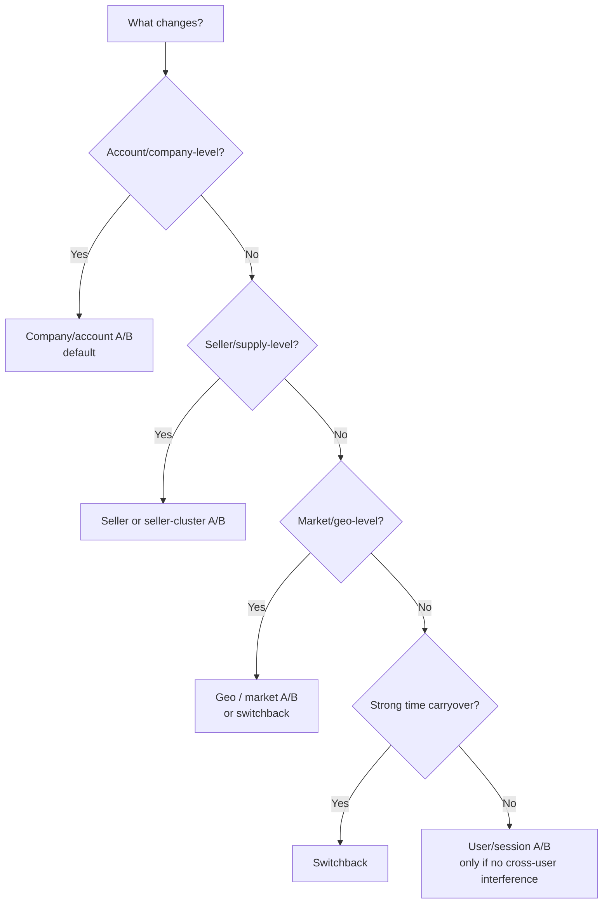

# 00 · Triage and minimum viable experiment

Use this when you need to move fast without skipping the decisions that make an experiment interpretable.

## The 10 questions before any design

1. **Decision**: what will we do differently if the result is positive, negative, or flat?
2. **Population**: which companies/accounts/sellers are eligible, and who is excluded?
3. **Lever**: what exactly changes, at which layer (UI, policy, price, tool, sales action)?
4. **Unit**: where does the intervention act, and where does interference travel?
5. **Outcome**: what is the one primary metric, over what window, with what denominator?
6. **Baseline**: what is the current value, and how noisy is it across accounts?
7. **MDE**: what is the smallest effect worth acting on?
8. **Guardrails**: what must not get worse, and who owns each threshold?
9. **Evidence**: what would make us disbelieve the result (SRM, contamination, novelty, harm)?
10. **Cost**: what does the experiment cost in money, seller/customer trust, and opportunity?

If questions 1, 4, 5, or 8 are unanswered, do not start.

## The 60-minute design sequence

| Minute | Action | Output |
|---:|---|---|
| 0–10 | Write the decision and hypothesis | One paragraph with mechanism + MDE |
| 10–20 | Choose the unit and check interference | Unit, cluster/geo/switchback rationale |
| 20–30 | Define primary, secondary, guardrail, counter-metric | Metric tree with owners |
| 30–40 | Compute power / MDE / sample | Power appendix with assumptions |
| 40–50 | Define exposure and analysis population | ITT vs exposed; event schema |
| 50–60 | Write decision rules and pre-register | Plan hash, thresholds, stop rules |

## Decision tree: which design?



If interference is likely and clustering is impossible, do not run a user-level test. Use a market-level design or a documented quasi-experiment.

## Minimum viable experiment spec

Copy this into the design doc; if a line is blank, the design is not ready.

```markdown
# EXP-{BU}-{YYYYMMDD}-{NNN}
- Decision:
- Owner / backup:
- Population / exclusions:
- Hypothesis (mechanism + MDE + refutation):
- Unit / hash salt / strata:
- Treatment / Control (version, config):
- Exposure event / dedupe:
- Split / ramp:
- Primary metric / window / denominator:
- Secondary / guardrail / counter-metric:
- Power: baseline, variance/ICC, MDE, alpha, power, expected attrition
- Analysis: ITT/TOT, estimator, cluster, CUPED, missing/outlier rules
- Subgroups (pre-registered):
- Decision rules: scale / target / iterate / stop / retest
- Guardrail owner / circuit breaker:
- Rollback:
```

## One-page review checklist

### Design

- [ ] Hypothesis is falsifiable and includes mechanism, MDE, and refutation.
- [ ] Unit matches intervention and interference; account/company is the default.
- [ ] Exposure is defined at the same unit as randomization.
- [ ] Control is current production, same period, no hidden feature.
- [ ] Split is 50/50 unless there is a pre-registered reason; ramp is not outcome-driven.
- [ ] Period covers at least one full business cycle; seasonality is addressed.
- [ ] Mutual exclusion / orthogonality is checked.
- [ ] Power calculation is reproducible and includes cluster/CUPED/attrition.

### Metrics

- [ ] One primary metric, directly tied to the hypothesis.
- [ ] 2–4 secondary metrics explain mechanism.
- [ ] 3–6 guardrails have thresholds and owners.
- [ ] Counter-metric detects gaming.
- [ ] 口径 includes numerator, denominator, window, dedupe, tax, refund, currency, exclusions.
- [ ] SQL is versioned, reviewed, and reproducible.

### Data quality

- [ ] SRM p ≥ 0.001 (or investigated if lower).
- [ ] Exposure rate and group difference are reported.
- [ ] Pre-period balance max SMD < 0.1 (or adjusted).
- [ ] Cross-arm contamination < 5% (or disclosed).
- [ ] Duplicate company/account rate < 2% (or corrected).
- [ ] Lineage, freshness, and reconciliation pass.

### Decision

- [ ] Decision rules were written before exposure.
- [ ] Primary result reports absolute + relative + CI + MDE.
- [ ] Guardrails are non-inferior or have a remediation plan.
- [ ] Subgroups are pre-registered and multiplicity-controlled.
- [ ] Long-term/holdout plan exists.
- [ ] Decision record names owner, rationale, dissent, and follow-up.

## Fast red flags

| Signal | Likely problem | First move |
|---|---|---|
| “We’ll randomize users but the price changes by company” | Unit/interference mismatch | Switch to company-level |
| “We’ll look at results daily and stop when significant” | Peeking / optional stopping | Pre-register sequential design |
| “The dashboard says +20%, p=0.04” | No SRM/CI/guardrail context | Run DQ gates before believing it |
| “We only have 300 accounts but expect +5%” | Underpowered | Compute MDE; change metric/window/design |
| “Sales will apply the treatment to whoever asks” | Contamination / non-compliance | Randomize by rep/territory; log CRM action |
| “We’ll use historical same period as control” | Confounding | Use concurrent control or a quasi-experiment with assumptions |
| “We’ll change the metric if it doesn’t move” | HARKing | Freeze the metric; new experiment for new question |
| “It worked in week 1” | Novelty/primacy | Check 30/60/90 and decay |

## When to stop and escalate

- No decision or no owner.
- No stable unit or no exposure log.
- Population too small for a credible MDE and no acceptable sensitivity lever.
- Guardrail owner vetoes the risk.
- Legal/finance has not signed off on pricing, contract, credit, or private data.
- The experiment cannot be rolled back.

Escalate with a one-page memo: decision, evidence gap, options, recommended path, and the cost of waiting.
