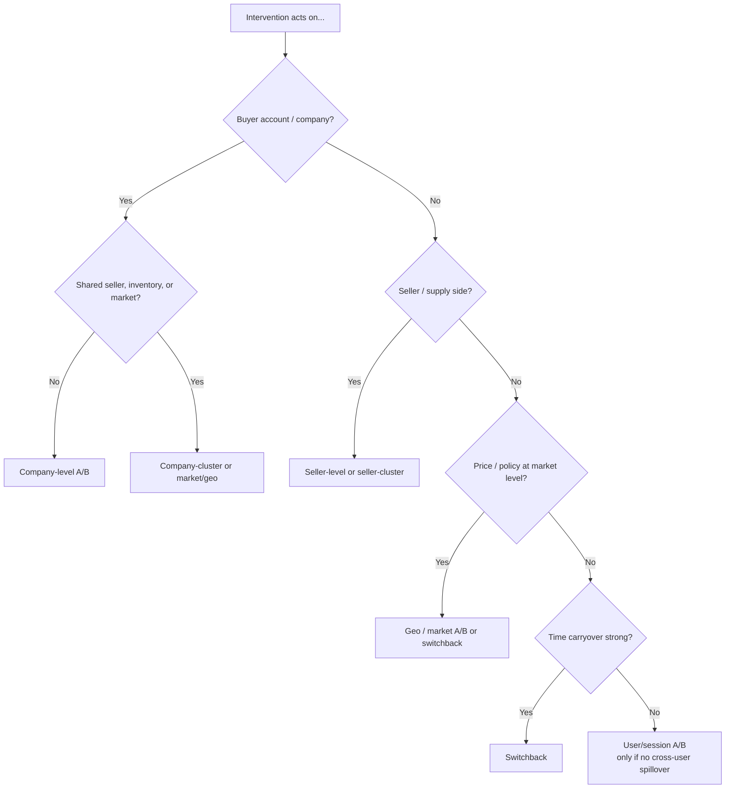

# 10 · Experiment design

Design is the set of choices that make a result causally interpretable. Fix them before exposure; anything changed afterward is an amendment.

## 1. Hypothesis

A usable hypothesis has four parts:

```text
Because [mechanism], changing [lever] for [population] will move [primary metric]
by at least [MDE] within [window], while [guardrail] stays within [threshold].
We would be wrong if [refutation condition].
```

Bad: “The new quote page will improve conversion.”
Good: “Because buyers abandon when lead time is hidden, showing a promised delivery date on the quote page will raise quote-to-order (Q2O) by ≥ 8% relative within 30 days for mid-market buyers, without raising quote cancellation above 12%; we would be wrong if Q2O is flat and quote latency rises.”

Rules:
- One primary mechanism per experiment. If you need two mechanisms, run two experiments or a factorial design with enough power.
- MDE is a business threshold, not the observed effect.
- Refutation includes both “no effect” and “harmful side effect.”

## 2. Randomization unit

### Decision tree



### Unit matrix

| Unit | Use when | Main risk | Analysis |
|---|---|---|---|
| Company/account | Default for buyer-side levers | Few clusters; multi-account | Cluster-robust at company |
| Buyer user | Low-ticket, self-serve, no account sharing | Spillover within company | User-level, check company clustering |
| Seller | Seller tools, fulfillment, onboarding | Seller-buyer entanglement | Cluster-robust at seller |
| Sales rep/territory | Incentives, CRM actions | Rep contamination, small N | Rep-level or territory-level |
| Market/geo | Pricing, supply, policy | Few treated markets, confounding | DID/synthetic control/randomization inference |
| Time block (switchback) | Carryover, shared inventory | Time trends, washout | Block FE, cluster by block |

**Default:** company/account. It matches the buyer decision, the contract, and most B2B interventions. Only move down to user when the intervention is genuinely user-scoped and there is no account-level sharing.

### Interference checklist

Ask these before choosing a unit:

- Can two buyers from the same company see different prices or features?
- Does one seller’s treatment change inventory or service for control buyers?
- Does the treatment change market price, rank, or supply?
- Can sales manually apply the treatment to control accounts?
- Does the treatment change the behavior of account managers across accounts?

If any answer is yes, cluster at the spillover boundary or change the design.

## 3. Assignment mechanics

### Hashing

- Hash `salt + unit_id` into `[0, 1)`; assign by bucket.
- Use a unique salt per experiment; never reuse a salt across layers.
- Store `salt`, `hash_version`, `unit_id`, `bucket`, `variant` in the assignment table.
- Deterministic assignment is required for reproducibility; do not use random row order.

### Stratification

Stratify on variables that predict the outcome and are stable pre-treatment:
- buyer segment / industry / region
- baseline GMV or order frequency
- new vs existing account
- seller tier / category

Use block randomization within strata; keep 2–4 strata variables to avoid tiny cells. Record the stratification spec and verify balance within strata.

### Cluster assignment

- Assign whole clusters; never split a cluster.
- Use an even number of clusters per arm; avoid 1–2 clusters per arm.
- Prefer 20+ clusters per arm; below that, use randomization inference or a small-sample correction and treat the result as fragile.
- Check cluster size variation; a few huge accounts can dominate.

### Switchback

- Divide time into blocks (e.g., 2-hour, daily, or weekly), randomize block order.
- Insert washout between blocks to limit carryover.
- Analyze with block fixed effects and cluster-robust errors at the time-block level.
- Pre-register the block length, washout, and carryover test.

### Geo / market

- Use matched pairs or synthetic control; pre-register the donor pool.
- Check pre-period fit and placebo tests.
- Few treated units means randomization inference, not asymptotic p-values.
- Do not use geo tests for changes that leak across borders (online pricing, national ads).

## 4. Treatment and control

- **Control is current production**, not “no feature” or a historical period. Same version, same config, same season.
- **Treatment is one change**, versioned; no bundled “also fix this” changes.
- **Blinding:** where possible, keep buyers/sellers unaware of arm; operational teams must not know which accounts are treated if they can influence outcomes.
- **Compliance:** log whether the treatment was actually delivered; analyze ITT first, then TOT/exposed as secondary.
- **Escalation:** define how support/sales handle treated vs control accounts; asymmetry is a confound.

## 5. Exposure

Define exposure in three layers:

1. **Assignment**: unit is in treatment bucket.
2. **Delivery**: treatment config was actually served/applied.
3. **Consumption**: unit saw/used the changed element.

Primary analysis uses **assignment (ITT)**. Secondary uses delivery or consumption, with explicit assumptions. Record:

- exposure event name, timestamp, unit ID, variant, surface, device/channel
- deduplication key and first-exposure rule
- exposure window vs experiment window
- ineligible/excluded units and reasons

Exposure rate by arm is a data-quality metric. A large imbalance means the treatment is not reaching the intended population or the logging is broken.

## 6. Split, ramp, and period

- **Split:** 50/50 by default. Unequal splits need a pre-registered reason (risk, capacity, seller fairness).
- **Ramp:** start 5–10%, then 25–50%, only after DQ gates pass. Ramp must not be based on outcome peeking.
- **Period:** cover at least one full business cycle (week/month/quarter). B2B cycles are long; 30 days is a floor, not a universal rule.
- **Seasonality:** avoid launching in a known peak unless the design accounts for it; use concurrent control and pre-period covariates.
- **Novelty/primacy:** report early vs late windows; do not declare success from week 1.

## 7. Mutual exclusion and layers

- One unit must not be in two experiments that change the same lever or metric in conflicting directions.
- Use experiment layers/domains (search, pricing, seller tools, CRM) with separate salts.
- Check overlap before launch: same unit in another active experiment, same surface, same population.
- If overlap is unavoidable, pre-register the interaction analysis and reduce power expectations.
- Factorial designs are allowed only when interactions are part of the question and power is sufficient.

## 8. Sample size and power

### Continuous outcome

```text
n per arm = 2 (z_{1-α/2} + z_{1-β})² σ² / Δ²
```

### Binary outcome

```text
n per arm = (z_{1-α/2} + z_{1-β})² [p1(1-p1) + p2(1-p2)] / (p2-p1)²
```

### Cluster randomized

```text
n clusters per arm = 2 (z_{1-α/2} + z_{1-β})² (σ_b² + σ_w²/m) / Δ²
DEFF = 1 + (m-1) ICC
```

Where `m` is cluster size, `σ_b²` between-cluster variance, `σ_w²` within-cluster variance, `ICC = σ_b²/(σ_b²+σ_w²)`.

### Practical adjustments

- Inflate for expected attrition/non-compliance: divide by `(1 - attrition)`.
- Inflate for CUPED conservatively; do not assume the full variance reduction.
- Inflate for multiple primary comparisons if you insist on more than one; better to have one primary.
- For ratio metrics, use the delta-method variance or simulate; do not plug a naive proportion variance.

### Worked example

Baseline Q2O = 10%, target relative lift 10% (10% → 11%), α=0.05 two-sided, power 80%:

```text
n/arm = 7.84 × (0.10×0.90 + 0.11×0.89) / 0.01²
      = 7.84 × (0.09 + 0.0979) / 0.0001
      ≈ 14,700 per arm
```

With 30% of buyers inactive, plan ~21,000 per arm; add a 10% dilution/contamination buffer → ~23,300. If only 8,000 accounts exist, the realistic MDE is larger; compute it rather than wish it away.

### MDE back-calculation

```text
MDE (absolute) = (z_{1-α/2} + z_{1-β}) √(2 σ² / n)
```

Report MDE next to every non-significant result.

## 9. Variance reduction: CUPED

Use pre-period outcome/covariate `X` to reduce variance:

```text
Y_adj = Y - θ (X - E[X]),  θ = Cov(Y, X) / Var(X)
```

Rules:
- Use only pre-treatment `X`; never post-treatment variables.
- Check correlation; if < 0.2, gain is small and added complexity may not pay.
- Use the same `X` definition and window in both arms.
- Pre-register CUPED as the primary estimator if used; report unadjusted as sensitivity.
- Do not use CUPED to rescue an underpowered design after the fact.

## 10. Special designs

### Cluster randomized

Use for seller, account, territory, or market spillover. Analyze at the assignment level with cluster-robust SE; report ICC and DEFF.

### Switchback

Use for shared supply, dispatch, or inventory where concurrent arms contaminate each other. Pre-register block length, washout, and carryover test.

### Geo test

Use for market-level pricing/policy where user-level split is impossible. Requires pre-period fit, placebo tests, and randomization inference.

### Holdout

Keep 5–10% of the rollout population untreated for 30–90 days after launch to measure long-term and cannibalization effects. Holdout must be randomized, not “the last market.”

### Factorial

Use only for two independent levers with a pre-specified interaction hypothesis; otherwise it multiplies sample-size and interpretation burden.

## 11. Design review checklist

- [ ] Decision, owner, and deadline are named.
- [ ] Hypothesis includes mechanism, MDE, window, and refutation.
- [ ] Unit matches intervention and interference; default is company/account.
- [ ] Assignment is deterministic, salted, and logged.
- [ ] Control is concurrent production; treatment is one change.
- [ ] Exposure is defined at the assignment unit; ITT is primary.
- [ ] Split and ramp are pre-registered; no outcome-driven ramp.
- [ ] Period covers a full business cycle; seasonality addressed.
- [ ] Power is reproducible; cluster/CUPED/attrition are explicit.
- [ ] Primary metric is singular; guardrails have owners and thresholds.
- [ ] Subgroups are pre-registered and limited.
- [ ] Mutual exclusion is checked.
- [ ] Rollback, circuit breaker, and escalation are defined.
- [ ] Pre-registration hash and amendment process are in place.

## 12. Common design failures

| Failure | Consequence | Fix |
|---|---|---|
| User-level split for account pricing | Control sees treatment price; bias | Company-level |
| Historical control | Seasonality/confounding | Concurrent control |
| Peeking daily | Inflated false positives | Sequential design or fixed horizon |
| Many primary metrics | p-hacking; no clear decision | One primary + secondaries |
| No exposure log | Can’t separate delivery from effect | Event schema before launch |
| Underpowered pilot | “No effect” with wide CI | Compute MDE; change design |
| Treatment bundled with bug fix | Can’t attribute | One change per experiment |
| Sales knows assignment | Differential effort | Blind ops or randomize by rep |
| No guardrail owner | Harm ships | Named owner + veto |
| Post-hoc subgroup | False discovery | Pre-register; interaction test |
